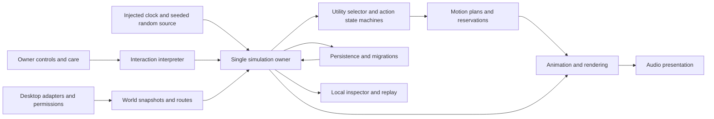

---
{"approval":null,"authority":"semantic","github_repository_id":1439196929,"id":"PRD-01b2bbbc-da9d-4602-ac03-ccfd6b484f11-a65269b3-3d1f-52cb-aaa4-23e1b9eefde4","lifecycle":"draft","mutability":"frozen_after_approval","provenance":[{"requirements":[{"acceptance_condition":"Sterling continues approved animation while another app is active, without activating Sterling. A, I","id":"REQ-STERLING-001","priority_and_slice":"P0 S1","source_dependencies":"R-026","source_id":"R-001","statement":"Independent Mac pet overlay, C"},{"acceptance_condition":"Each chosen action has a valid opportunity and recorded motivating state. A","id":"REQ-STERLING-002","priority_and_slice":"P0 S2","source_dependencies":"R-004, R-031","source_id":"R-002","statement":"Contextual autonomous choice, C"},{"acceptance_condition":"Hungry/sleepy, affectionate/nonplayful, and energetic/solitary fixtures produce distinct choices. A, X1","id":"REQ-STERLING-003","priority_and_slice":"P0 S2","source_dependencies":"R-004","source_id":"R-003","statement":"Stable temperament with independent needs, C"},{"acceptance_condition":"All state remains in range under long and adversarial replays. X1","id":"REQ-STERLING-004","priority_and_slice":"P0 S2","source_dependencies":"R-039","source_id":"R-004","statement":"Bounded state across four timescales, C"},{"acceptance_condition":"One valid brief stroke receives a visible acknowledgment within the proposed latency budget. B","id":"REQ-STERLING-005","priority_and_slice":"P0 S1","source_dependencies":"R-026, R-033","source_id":"R-005","statement":"Fleeting acknowledgment, C"},{"acceptance_condition":"A receptive fixture rises, plateaus, and ends; reopening Pet preserves satisfaction and stimulation. C","id":"REQ-STERLING-006","priority_and_slice":"P0 S1","source_dependencies":"R-004, R-005","source_id":"R-006","statement":"Petting with rising desire and a natural end, C"},{"acceptance_condition":"Warning posture precedes withdrawal; rough input never moves or clicks the real pointer. C, I","id":"REQ-STERLING-007","priority_and_slice":"P0 S1","source_dependencies":"R-006","source_id":"R-007","statement":"Readable contact boundaries, C"},{"acceptance_condition":"Pursuit declines or ends; immediate reopening does not restore initial interest. D","id":"REQ-STERLING-008","priority_and_slice":"P0 S2","source_dependencies":"R-004, R-027","source_id":"R-008","statement":"Interactive play arc with retained fatigue, C"},{"acceptance_condition":"Slow drags, darts, pauses, catch, hold, and release influence the session. D","id":"REQ-STERLING-009","priority_and_slice":"P0 S2","source_dependencies":"R-008, R-031","source_id":"R-009","statement":"Mouse on a string, C"},{"acceptance_condition":"Dot stays in valid play space; finish offers a catchable toy or treat, without forcing feeding. D, I","id":"REQ-STERLING-010","priority_and_slice":"P1 S4","source_dependencies":"R-008, R-027","source_id":"R-010","statement":"Laser mode with satisfying closure, C"},{"acceptance_condition":"Batting, carrying, hiding, and rediscovery use persistent virtual objects. G","id":"REQ-STERLING-011","priority_and_slice":"P1 S3","source_dependencies":"R-021, R-031","source_id":"R-011","statement":"Autonomous loose toys, C"},{"acceptance_condition":"Sniff, decide, bite, pause, eat, and settle update state only for consumed portions. F","id":"REQ-STERLING-012","priority_and_slice":"P0 S2","source_dependencies":"R-004, R-021","source_id":"R-012","statement":"Hunger, meal sequence, and satiety, C"},{"acceptance_condition":"Stable taste, novelty reluctance, and recent repetition can be distinguished in controlled fixtures. F","id":"REQ-STERLING-013","priority_and_slice":"P0 S2","source_dependencies":"R-012, R-038","source_id":"R-013","statement":"Flavor, texture, familiarity, and repetition, C"},{"acceptance_condition":"A hungry receptive cat accepts basic food; refusing another flavor creates no penalty. F","id":"REQ-STERLING-014","priority_and_slice":"P0 S2","source_dependencies":"R-013","source_id":"R-014","statement":"Always-acceptable basic food and safe alternative, C"},{"acceptance_condition":"Repeated treats fill satiety modestly and cannot accelerate familiarity without bound. X1","id":"REQ-STERLING-015","priority_and_slice":"P1 S4","source_dependencies":"R-012, R-038","source_id":"R-015","statement":"Treats with diminishing effect, C"},{"acceptance_condition":"Sterling can drink autonomously; absence of water never creates damage or a new chore loop. G, J","id":"REQ-STERLING-016","priority_and_slice":"P1 S4","source_dependencies":"R-021","source_id":"R-016","statement":"Lightweight water routine, C"},{"acceptance_condition":"No more than two active bids in any rolling 20 minutes; unanswered sequence delays the next by at least 15 minutes. E","id":"REQ-STERLING-017","priority_and_slice":"P0 S2","source_dependencies":"R-004, R-039","source_id":"R-017","statement":"Global attention budget and retreat, C; limits P"},{"acceptance_condition":"Silent observer can identify the requested category from object, gaze, and posture. E, K","id":"REQ-STERLING-018","priority_and_slice":"P1 S4","source_dependencies":"R-017, R-033","source_id":"R-018","statement":"Food, play, contact, and proximity bids differ, C"},{"acceptance_condition":"Call can be declined; Show locates or visibly recovers him within two seconds on an available display. H, K","id":"REQ-STERLING-019","priority_and_slice":"P0 S1","source_dependencies":"R-028","source_id":"R-019","statement":"Call versus reliable Show Sterling, C"},{"acceptance_condition":"Pet, groom, meals, treats, water, toys, tree, scratcher, nook, box, call, and controls are reachable. K, X2","id":"REQ-STERLING-020","priority_and_slice":"P1 S4","source_dependencies":"R-009–R-016, R-022","source_id":"R-020","statement":"Complete compact toolkit, C"},{"acceptance_condition":"Behavior depends on properties such as playable or soft, not a hard-coded menu label. G, X1","id":"REQ-STERLING-021","priority_and_slice":"P0 S2","source_dependencies":"R-030","source_id":"R-021","statement":"Objects expose usable affordances, C"},{"acceptance_condition":"Routes and use work autonomously; nook remains a persistent home base. G","id":"REQ-STERLING-022","priority_and_slice":"P1 S3","source_dependencies":"R-021, R-031","source_id":"R-022","statement":"Tree, nook, scratcher, and box or tunnel, C"},{"acceptance_condition":"Invalid placement cannot commit; occupied furniture remains until exit or explicit recovery completes. G, H","id":"REQ-STERLING-023","priority_and_slice":"P0 S3","source_dependencies":"R-030, R-028","source_id":"R-023","statement":"Placement, exclusions, and safe removal, C"},{"acceptance_condition":"Enabled ledges pass movement, close, resize, stale-data, and stacking tests; otherwise feature is unavailable. H","id":"REQ-STERLING-024","priority_and_slice":"P1 G after S3","source_dependencies":"R-029, R-031","source_id":"R-024","statement":"Optional window ledges, C desired; mechanism V"},{"acceptance_condition":"Virtual folder entry works without file access; real icon mode requires separate evidence. G, I","id":"REQ-STERLING-025","priority_and_slice":"P1 S3, real anchor G","source_dependencies":"R-022, R-028","source_id":"R-025","statement":"Folder entry theatre, C; real anchoring V"},{"acceptance_condition":"No unrelated click or drag is intercepted or synthesized; typing focus stays with the owner's app. I","id":"REQ-STERLING-026","priority_and_slice":"P0 S1","source_dependencies":"FZ-01","source_id":"R-026","statement":"Transparent-area input integrity, C"},{"acceptance_condition":"Pet/play gestures begin deliberately and finish or cancel without affecting underlying content. I","id":"REQ-STERLING-027","priority_and_slice":"P0 S1","source_dependencies":"R-026","source_id":"R-027","statement":"Explicit gesture ownership and cancellation, C"},{"acceptance_condition":"Invalid support cannot remain committed; Show and display-loss recovery produce an explanatory visual transition. H, L","id":"REQ-STERLING-028","priority_and_slice":"P0 S1/S3","source_dependencies":"R-030","source_id":"R-028","statement":"Safe environmental recovery, C"},{"acceptance_condition":"Denial/revocation preserves all base care; no prompt on first launch for desktop integration. I, L","id":"REQ-STERLING-029","priority_and_slice":"P0 S1","source_dependencies":"FZ-03","source_id":"R-029","statement":"Minimal permissions with full fallback, C"},{"acceptance_condition":"Correct scale, safe areas, exclusions, mirror handling, and disconnect recovery pass the matrix. H, L","id":"REQ-STERLING-030","priority_and_slice":"P0 S3","source_dependencies":"FZ-02","source_id":"R-030","statement":"Multiple displays and usable habitat geometry, C"},{"acceptance_condition":"Plans reserve reachable supports, validate landing, and never jump to stale geometry. H","id":"REQ-STERLING-031","priority_and_slice":"P0 S1/S3","source_dependencies":"R-030","source_id":"R-031","statement":"Supported routes, jumps, and landings, C"},{"acceptance_condition":"No duplicated cat or unsolicited Space switch; conservative hiding and manual control remain usable. H, K","id":"REQ-STERLING-032","priority_and_slice":"P0 S3","source_dependencies":"FZ-02","source_id":"R-032","statement":"Spaces and full-screen behavior, C; mechanism V"},{"acceptance_condition":"Breathing, anticipation, contact, gaze, ears, tail, and compatible transitions pass art review at desktop scale. A–D","id":"REQ-STERLING-033","priority_and_slice":"P0 S1/S4","source_dependencies":"R-031","source_id":"R-033","statement":"Grounded expressive animation, C"},{"acceptance_condition":"Per-category mute works; every consequential cue has a visual equivalent. K","id":"REQ-STERLING-034","priority_and_slice":"P1 S4","source_dependencies":"R-033","source_id":"R-034","statement":"Restrained optional audio, C"},{"acceptance_condition":"Core care and control scenarios complete using keyboard and VoiceOver without gestures. K","id":"REQ-STERLING-035","priority_and_slice":"P0 S1/S4","source_dependencies":"R-020","source_id":"R-035","statement":"Keyboard and assistive access, C"},{"acceptance_condition":"Commands preempt all bid phases; hide/quit stop new rendering and audio promptly. E, K","id":"REQ-STERLING-036","priority_and_slice":"P0 S1","source_dependencies":"R-027","source_id":"R-036","statement":"Quiet, focus, hide, pause, and quit precedence, C"},{"acceptance_condition":"Expression survives motion reduction; maximum attention setting never exceeds the safety cap. K","id":"REQ-STERLING-037","priority_and_slice":"P0 S1/S4","source_dependencies":"R-033","source_id":"R-037","statement":"Reduced motion, jumping, scale, and frequency controls, C"},{"acceptance_condition":"Discoveries arise from observed evidence; repeated action cannot create infinite growth. F, L","id":"REQ-STERLING-038","priority_and_slice":"P1 S2/S4","source_dependencies":"R-004, R-041","source_id":"R-038","statement":"Persistent familiarity, preferences, and notebook, C"},{"acceptance_condition":"Hide, sleep, long absence, backward clock, and timezone changes create no care debt. J, X3","id":"REQ-STERLING-039","priority_and_slice":"P0 S2","source_dependencies":"R-004","source_id":"R-039","statement":"Explicit time semantics and forgiving return, C"},{"acceptance_condition":"Base experience starts and continues offline; no account endpoint or required network service. X4","id":"REQ-STERLING-040","priority_and_slice":"P0 S1","source_dependencies":"R-042","source_id":"R-040","statement":"Local operation without an account, P"},{"acceptance_condition":"Restart restores semantic continuity; corrupt/incompatible saves do not silently destroy memories. L, X5","id":"REQ-STERLING-041","priority_and_slice":"P0 S2","source_dependencies":"R-039","source_id":"R-041","statement":"Atomic persistence and migrations, C"},{"acceptance_condition":"No input injection, file mutations, window activation, document reading, or ambient recording in autonomous paths. I, X4","id":"REQ-STERLING-042","priority_and_slice":"P0 all","source_dependencies":"R-026, R-029","source_id":"R-042","statement":"Privacy and prohibition on real-world side effects, C"},{"acceptance_condition":"Measured release build satisfies section 10 budgets, including hidden and inactive modes. X6","id":"REQ-STERLING-043","priority_and_slice":"P0 all","source_dependencies":"FZ-04","source_id":"R-043","statement":"Resource budgets and power adaptation, C; numbers P"},{"acceptance_condition":"Same build/content, seed, clock, and events reproduce decisions and semantic state. X1","id":"REQ-STERLING-044","priority_and_slice":"P0 S2","source_dependencies":"R-004, R-039","source_id":"R-044","statement":"Reproducible behavior and inspection, C"},{"acceptance_condition":"Settings, layout, and memories have distinct reset flows; cancellation preserves all state. X5","id":"REQ-STERLING-045","priority_and_slice":"P1 S4","source_dependencies":"R-041","source_id":"R-045","statement":"Reset with separate consequences, C"},{"acceptance_condition":"No death/illness/debt, dialogue generation, store, streak, or relationship loss is introduced. J, X2","id":"REQ-STERLING-046","priority_and_slice":"P0 all","source_dependencies":"R-039","source_id":"R-046","statement":"No punitive absence, speech, or monetization loop, P supported by REQ-06"},{"acceptance_condition":"Every catalog family ships with launch entries; expansion entries remain tracked. A, X7","id":"REQ-STERLING-047","priority_and_slice":"P1 S4","source_dependencies":"R-002, R-033","source_id":"R-047","statement":"Behavioral breadth and nonrepetition, C"},{"acceptance_condition":"Selected signing, permissions, architecture, and OS matrix are proven in the distributable build. X8","id":"REQ-STERLING-048","priority_and_slice":"P0 S0","source_dependencies":"FZ-03, FZ-05","source_id":"R-048","statement":"Distribution and supported platform policy, P/V"}]},{"intake":"Preserved previously approved input; canonical intake remains draft. Original R identifiers remain authoritative source identifiers; REQ aliases are a one-to-one tooling map.","source_commit":"d4409c85f5e5beebe1b668cb027060d1ec3aa497","source_path":"docs/reference/approved-product-specification-v1.md","source_sha256":"16b6b4bf4c471e456d98d4f04d9b2f26ba100f049d39d0616b6ec5f600f1c15d"}],"relations":[],"repository_key":"01b2bbbc-da9d-4602-ac03-ccfd6b484f11","schema":"doc-warden/artifact/v2","supersedes":null,"type":"prd","version":1}
---
# sterling.io product specification and architecture scaffold

Version: v0.1  
Status: Draft for founder and engineering review  
Last updated: 2026-10-29  
Scope: Product definition, architecture contracts, feasibility gates, and delivery sequencing. Application implementation follows this specification.

sterling.io is a virtual cat who shares the owner's Mac: **a little life on your Mac**. The experience succeeds when Sterling notices something, chooses what to do, enjoys it, tires of it, and returns to a familiar place. The owner should recognize a companion through recurring habits without having to manage him continuously.

Recommend a local, single-cat Mac application with native controls, a deterministic character simulation, and a softly realistic 2.5D presentation. Build a complete habitat from app-owned objects first. Treat real window ledges and real folder anchoring as optional integrations behind explicit feasibility gates. Prove input safety, movement continuity, and one satisfying petting arc before committing to the full animation inventory.

**Status vocabulary:** **C — confirmed** means required by the supplied brief. **P — proposed** means a concrete default recommended here, including all numeric tuning, architecture choices, priorities, and release assignments. **V — validation required** means evidence or a founder decision must settle the choice. A confirmed desired experience does not establish the feasibility of its proposed macOS mechanism.

The founder's reference image is mentioned in the brief but was not included with the text available for this specification. Coat, markings, proportions, and likeness therefore remain an art approval decision. The proposed temperament is fictional design material; it makes no claim about the real Sterling.

## 1 Product intent and reconciled scope

### Emotional design principles

| Original principle | Product interpretation | Design consequence |
| --- | --- | --- |
| REQ-01 Agency | Sterling has preferences and an activity of his own. | Invitations may be declined; administrative controls always work. |
| REQ-02 Understandable causes | A change in behavior should follow a need, event, or opportunity. | Store decision reasons; choose variations within an appropriate action. |
| REQ-03 Small moments | Life is visible in breathing, attention, and anticipation. | Quiet poses receive animation effort comparable to tricks. |
| REQ-04 Respect work | Presence should be compatible with concentration. | Attention is globally budgeted; hiding and quiet controls override character behavior. |
| REQ-05 Continuity | Familiarity appears in places, choices, and rituals. | Persist preferences and habits, never a record of the owner's work. |
| REQ-06 Forgiving care | Returning should feel welcoming. | Absence creates no debt, relationship loss, or queued appeals. |

The primary owner is someone who wants ambient companionship while using a Mac. Their central job is to share space with Sterling and occasionally participate in a small ritual. The application is not a productivity assistant, animal-health simulator, or obligation system. No therapeutic outcome is claimed.

**Proposed launch defaults:** one Sterling; local storage; no account; no ongoing network dependency; no speech or chatbot; no death, illness, or neglect penalties; no store or subscription infrastructure; menu bar entry; a summonable care tray; restrained sound initially muted until enabled. Learning changes familiarity and preferences, not Sterling's species or core temperament.

### Reconciliations that govern implementation

1. **Agency versus control:** Call is an invitation. Show Sterling, Settle, Pause, Hide, and Quit are owner commands. Character mood can change the exit animation but cannot veto the command.
2. **Desktop illusion versus access:** a virtual folder provides the hideaway experience at launch. Anchoring that illusion to a real Finder icon is separately gated; neither implementation accesses folder contents.
3. **Direct touch versus input integrity:** passive visuals pass through mouse input. Deliberate interaction begins in a visible care area. Direct interaction on Sterling's irregular silhouette is an enhancement only if prototypes prove it cannot capture unrelated clicks.
4. **Hunger versus forgiving care:** hunger motivates meals and capped invitations. It does not create escalating distress. A generous basic food and optional default automatic basic meal keep care winnable.
5. **Independent life versus low power:** simulation and rendering have separate clocks. Sleeping is active character behavior with sparse visual updates; hiding suspends ordinary need accumulation.
6. **Memory versus surveillance:** remember interactions with Sterling and app-owned places. Never remember window titles, document text, URLs, typed content, or meeting participants.
7. **Realistic movement versus unavailable surfaces:** routes require valid support. Prefer app-owned surfaces; a visible tuck-away and reappearance is reserved for an environment that disappears too quickly for a physical exit.
8. **Full vision versus sequencing:** all behavior examples remain in the catalog. Launch covers every family and every requested toolkit category; individually deferred variations and desktop integrations are explicitly marked.

### Experience anchors

**Quiet company:** Sterling wakes in his nook, stretches, washes his face, watches nearby movement, then changes his mind and settles. There is no prompt to reward the owner for noticing.

**A little ritual:** the owner opens Pet, strokes his head, and sees a turn toward contact. Continued gentle strokes bring a chin lift and lean. Later he flicks his tail, looks away, and settles. A brief touch was enough; a longer interaction also had a natural end.

**Continuity:** after a few positive encounters with the mouse toy, Sterling sometimes chooses it himself. After being away for days, the owner finds him comfortable. His preferences remain; there is no backlog of missed care.

## 2 Requirements catalog

Priorities and delivery assignments below are proposals. **P0** is foundational or safety-critical; **P1** completes the launch experience; **P2** expands depth. **S1–S4** refer to delivery slices in section 10. **G** means a gated optional integration, not an unconditional launch dependency. Acceptance references A–L retain the brief's identifiers; X1–X8 cover additional requirements. A requirement passes only when both its row condition and its referenced scenario pass. The implementation agent must not silently downgrade C requirements.

| ID | Requirement and status | Priority and slice | Depends on | Acceptance condition |
| --- | --- | --- | --- | --- |
| R-001 | Independent Mac pet overlay, C | P0 S1 | R-026 | Sterling continues approved animation while another app is active, without activating Sterling. A, I |
| R-002 | Contextual autonomous choice, C | P0 S2 | R-004, R-031 | Each chosen action has a valid opportunity and recorded motivating state. A |
| R-003 | Stable temperament with independent needs, C | P0 S2 | R-004 | Hungry/sleepy, affectionate/nonplayful, and energetic/solitary fixtures produce distinct choices. A, X1 |
| R-004 | Bounded state across four timescales, C | P0 S2 | R-039 | All state remains in range under long and adversarial replays. X1 |
| R-005 | Fleeting acknowledgment, C | P0 S1 | R-026, R-033 | One valid brief stroke receives a visible acknowledgment within the proposed latency budget. B |
| R-006 | Petting with rising desire and a natural end, C | P0 S1 | R-004, R-005 | A receptive fixture rises, plateaus, and ends; reopening Pet preserves satisfaction and stimulation. C |
| R-007 | Readable contact boundaries, C | P0 S1 | R-006 | Warning posture precedes withdrawal; rough input never moves or clicks the real pointer. C, I |
| R-008 | Interactive play arc with retained fatigue, C | P0 S2 | R-004, R-027 | Pursuit declines or ends; immediate reopening does not restore initial interest. D |
| R-009 | Mouse on a string, C | P0 S2 | R-008, R-031 | Slow drags, darts, pauses, catch, hold, and release influence the session. D |
| R-010 | Laser mode with satisfying closure, C | P1 S4 | R-008, R-027 | Dot stays in valid play space; finish offers a catchable toy or treat, without forcing feeding. D, I |
| R-011 | Autonomous loose toys, C | P1 S3 | R-021, R-031 | Batting, carrying, hiding, and rediscovery use persistent virtual objects. G |
| R-012 | Hunger, meal sequence, and satiety, C | P0 S2 | R-004, R-021 | Sniff, decide, bite, pause, eat, and settle update state only for consumed portions. F |
| R-013 | Flavor, texture, familiarity, and repetition, C | P0 S2 | R-012, R-038 | Stable taste, novelty reluctance, and recent repetition can be distinguished in controlled fixtures. F |
| R-014 | Always-acceptable basic food and safe alternative, C | P0 S2 | R-013 | A hungry receptive cat accepts basic food; refusing another flavor creates no penalty. F |
| R-015 | Treats with diminishing effect, C | P1 S4 | R-012, R-038 | Repeated treats fill satiety modestly and cannot accelerate familiarity without bound. X1 |
| R-016 | Lightweight water routine, C | P1 S4 | R-021 | Sterling can drink autonomously; absence of water never creates damage or a new chore loop. G, J |
| R-017 | Global attention budget and retreat, C; limits P | P0 S2 | R-004, R-039 | No more than two active bids in any rolling 20 minutes; unanswered sequence delays the next by at least 15 minutes. E |
| R-018 | Food, play, contact, and proximity bids differ, C | P1 S4 | R-017, R-033 | Silent observer can identify the requested category from object, gaze, and posture. E, K |
| R-019 | Call versus reliable Show Sterling, C | P0 S1 | R-028 | Call can be declined; Show locates or visibly recovers him within two seconds on an available display. H, K |
| R-020 | Complete compact toolkit, C | P1 S4 | R-009–R-016, R-022 | Pet, groom, meals, treats, water, toys, tree, scratcher, nook, box, call, and controls are reachable. K, X2 |
| R-021 | Objects expose usable affordances, C | P0 S2 | R-030 | Behavior depends on properties such as playable or soft, not a hard-coded menu label. G, X1 |
| R-022 | Tree, nook, scratcher, and box or tunnel, C | P1 S3 | R-021, R-031 | Routes and use work autonomously; nook remains a persistent home base. G |
| R-023 | Placement, exclusions, and safe removal, C | P0 S3 | R-030, R-028 | Invalid placement cannot commit; occupied furniture remains until exit or explicit recovery completes. G, H |
| R-024 | Optional window ledges, C desired; mechanism V | P1 G after S3 | R-029, R-031 | Enabled ledges pass movement, close, resize, stale-data, and stacking tests; otherwise feature is unavailable. H |
| R-025 | Folder entry theatre, C; real anchoring V | P1 S3, real anchor G | R-022, R-028 | Virtual folder entry works without file access; real icon mode requires separate evidence. G, I |
| R-026 | Transparent-area input integrity, C | P0 S1 | FZ-01 | No unrelated click or drag is intercepted or synthesized; typing focus stays with the owner's app. I |
| R-027 | Explicit gesture ownership and cancellation, C | P0 S1 | R-026 | Pet/play gestures begin deliberately and finish or cancel without affecting underlying content. I |
| R-028 | Safe environmental recovery, C | P0 S1/S3 | R-030 | Invalid support cannot remain committed; Show and display-loss recovery produce an explanatory visual transition. H, L |
| R-029 | Minimal permissions with full fallback, C | P0 S1 | FZ-03 | Denial/revocation preserves all base care; no prompt on first launch for desktop integration. I, L |
| R-030 | Multiple displays and usable habitat geometry, C | P0 S3 | FZ-02 | Correct scale, safe areas, exclusions, mirror handling, and disconnect recovery pass the matrix. H, L |
| R-031 | Supported routes, jumps, and landings, C | P0 S1/S3 | R-030 | Plans reserve reachable supports, validate landing, and never jump to stale geometry. H |
| R-032 | Spaces and full-screen behavior, C; mechanism V | P0 S3 | FZ-02 | No duplicated cat or unsolicited Space switch; conservative hiding and manual control remain usable. H, K |
| R-033 | Grounded expressive animation, C | P0 S1/S4 | R-031 | Breathing, anticipation, contact, gaze, ears, tail, and compatible transitions pass art review at desktop scale. A–D |
| R-034 | Restrained optional audio, C | P1 S4 | R-033 | Per-category mute works; every consequential cue has a visual equivalent. K |
| R-035 | Keyboard and assistive access, C | P0 S1/S4 | R-020 | Core care and control scenarios complete using keyboard and VoiceOver without gestures. K |
| R-036 | Quiet, focus, hide, pause, and quit precedence, C | P0 S1 | R-027 | Commands preempt all bid phases; hide/quit stop new rendering and audio promptly. E, K |
| R-037 | Reduced motion, jumping, scale, and frequency controls, C | P0 S1/S4 | R-033 | Expression survives motion reduction; maximum attention setting never exceeds the safety cap. K |
| R-038 | Persistent familiarity, preferences, and notebook, C | P1 S2/S4 | R-004, R-041 | Discoveries arise from observed evidence; repeated action cannot create infinite growth. F, L |
| R-039 | Explicit time semantics and forgiving return, C | P0 S2 | R-004 | Hide, sleep, long absence, backward clock, and timezone changes create no care debt. J, X3 |
| R-040 | Local operation without an account, P | P0 S1 | R-042 | Base experience starts and continues offline; no account endpoint or required network service. X4 |
| R-041 | Atomic persistence and migrations, C | P0 S2 | R-039 | Restart restores semantic continuity; corrupt/incompatible saves do not silently destroy memories. L, X5 |
| R-042 | Privacy and prohibition on real-world side effects, C | P0 all | R-026, R-029 | No input injection, file mutations, window activation, document reading, or ambient recording in autonomous paths. I, X4 |
| R-043 | Resource budgets and power adaptation, C; numbers P | P0 all | FZ-04 | Measured release build satisfies section 10 budgets, including hidden and inactive modes. X6 |
| R-044 | Reproducible behavior and inspection, C | P0 S2 | R-004, R-039 | Same build/content, seed, clock, and events reproduce decisions and semantic state. X1 |
| R-045 | Reset with separate consequences, C | P1 S4 | R-041 | Settings, layout, and memories have distinct reset flows; cancellation preserves all state. X5 |
| R-046 | No punitive absence, speech, or monetization loop, P supported by REQ-06 | P0 all | R-039 | No death/illness/debt, dialogue generation, store, streak, or relationship loss is introduced. J, X2 |
| R-047 | Behavioral breadth and nonrepetition, C | P1 S4 | R-002, R-033 | Every catalog family ships with launch entries; expansion entries remain tracked. A, X7 |
| R-048 | Distribution and supported platform policy, P/V | P0 S0 | FZ-03, FZ-05 | Selected signing, permissions, architecture, and OS matrix are proven in the distributable build. X8 |

## 3 Character state and time

### State ownership and bounds

All values below are **proposed tuning defaults**, not claims about animal physiology. Scalar state uses clamped values in [0,1] unless stated otherwise. Use seconds as the storage unit; rates labeled per minute must be converted once. Apply continuous rates with elapsed simulation time, and discrete effects once at a committed semantic event. Rendering frames never award meals, affection, or familiarity.

Stable temperament starts at curiosity 0.70, sociability 0.60, independence 0.65, playfulness 0.65, and sensory sensitivity 0.50. These are persistent biases, not commands or facts about the real Sterling. Session mood is derived from state and recent events: relaxed, curious, playful, affectionate, hungry, tired, hesitant, or overstimulated. Mood cannot overwrite the underlying dimensions.

Persistence classes: **D** durable across restart; **R** persisted but reconciled on return; **S** session-only, reset through a safe recovery state. The rates form a first tuning profile, `temperament.sterling.v1`.

| State | Initial value and update | Recovery and persistence | Observable expression |
| --- | --- | --- | --- |
| Hunger H | 0.25; +0.003/active minute, cap 0.80; consumed meal fraction p subtracts 0.50p | R; long return brings H into [0.20,0.45] | Bowl visits, sniffing, look-back; never escalating distress |
| Satiety V | 0.35; −0.004/active minute; meal adds 0.70p | R; long return brings V into [0.30,0.60] | Slower bites, lick lips, leave bowl |
| Energy E | 0.75; −0.0012/awake minute; pursuit additionally −0.0015/second | +0.015/sleep minute; R | Speed, jump eligibility, recovery duration |
| Sleep pressure W | 0.20; +0.0015/awake minute; +0.0004/pursuit second | −0.020/sleep minute; R | Heavy eyelids, loaf, curling up |
| Social appetite S | 0.55; +0.002/awake minute without contact, cap 0.80 | Positive contact −0.003/second; quiet nearby rest −0.0005/minute; R | Approach versus content solitude |
| Contact desire D | 0.45; petting equation below; distinct from general social appetite | Moves toward 0.2S while not touching; R | Head offer, chin lift, renewed nudge |
| Contact satisfaction Z | 0; +0.009 per second of quality contact | −0.004/second without contact; R, never reset by reopening Pet | Lean gives way to stillness, drowsiness, departure |
| Play motivation M | 0.60; +0.003/resting minute, −0.002/pursuit second, −0.025/catch | R; no immediate reset for a different session ID | Stalking readiness and willingness to renew pursuit |
| Arousal A | 0.15; +0.006/pursuit second or +0.06 for a startling virtual event | Exponential decay toward 0.12 with 20-second time constant in quiet; R | Tail, pupil/gaze, faster anticipation |
| Comfort C | 0.80; moves toward 0.90 on soft familiar support with 60-second time constant | Environmental invalidation subtracts at most 0.15; restores on valid support; R | Loose posture, breathing, kneading |
| Perceived safety K | 0.95; invalid support sets at most 0.55; no penalties from owner absence | On verified support returns toward 0.95 over 10 seconds; R | Hesitation and cautious descent, never fear theatre |
| Curiosity Q | 0.55; +0.15 per newly placed object once, −0.10 after successful investigation | Moves toward trait baseline 0.70 over 30 active minutes; R | Ears forward, sniff, peek, pauses |
| Overstimulation O | 0; contact equation below; vigorous play adds 0.001/second | −0.008/quiet second; R | Tail flick, ear rotation, turning away, withdrawal |
| Toy boredom B[t] | 0 for a toy; +0.004/engaged second plus 0.025 for a repeated identical pattern | −0.002/active minute while unavailable/not used; D with elapsed active time | Slower renewal, watching instead of chasing |
| Toy novelty N[t] | 0.80 for first discovery; −0.002/engaged second, floor 0.05 | +0.01/active hour out of use, cap 0.50 after first discovery; D | Longer initial investigation of unfamiliar toys |
| Toy preference P[t] | 0.50; completed enjoyable sessions move by at most 0.01 toward observed enjoyment | No absence decay; D | Which toy he approaches or brings |
| Taste affinity T[f] | [−1,1]; basic food fixed 0.50; proposed flavor seed fixed once per cat | Stable, never rerolled on restart; D | Eagerness, hesitation, exploratory bite |
| Food familiarity F[f] | 0.10 for new flavors; +0.08 per distinct tasted meal, max once per 30 active minutes | No forgetting penalty; D | Less novelty hesitation |
| Food repetition Bf[f] | 0; +0.25/consumed meal of same flavor | −0.04/active hour; alternative meal subtracts 0.10 from other flavors; D | Temporary reluctance despite stable liking |
| Treat repetition Bt | 0; +0.20 per accepted treat | −0.05/active minute; R | Slower approach or polite decline |
| Familiarity L | 0.15; positive sessions update through bounded rule below | Never decreases from absence, ignored bids, refusal, or boundary cues; D | Shorter approach hesitation and favorite rituals |
| Place affinity A[p] | 0.50; +0.02 for a comfortable rest of at least 2 minutes | Decay only for invalidated app-owned location, not owner absence; D | Returning to a nook or favored perch |

Hunger and satiety are separate drives: eating provides immediate fullness while hunger relief reflects consumed food. Energy is available capacity; sleep pressure is accumulated wakefulness. A cat with energy can still prefer sleep. Safety describes support certainty, not surveillance-derived threat detection. Water is a behavior opportunity; launch has no thirst meter.

### Petting dynamics

Let c be 1 during deliberate contact and 0 otherwise. Quality q is [0,1], derived from location, speed, continuity, and receptiveness. Per-second derivatives, clamped after integration:

```text
dD/dt = c * (0.09*q*(1-D) - 0.07*Z*D - 0.06*O*D)
        - (1-c)*0.035*(D - 0.2*S)
dZ/dt = c*0.009*q - (1-c)*0.004
dO/dt = c*(0.002*q + 0.025*(1-q)) - (1-c)*0.008
R = clamp01(0.15 + 0.65*D + 0.20*S - 0.75*Z - 0.65*O
            - 0.25*A - 0.30*W - 0.20*H)
```

At entry, R ≥ 0.20 allows gentle contact; lower values produce acknowledgment and a boundary cue. Gentle contact raises D initially, while Z and O accumulate and eventually reduce R. Continue a receptive session until Z ≥ 0.80, O ≥ 0.65, or R < 0.12 for two seconds. A proposed 150-second continuous-contact ceiling provides a final guard. Reaching any limit yields a visible boundary and a soft exit, never punishment. On a brief interruption retain D, Z, and O; a pause therefore allows partial recovery without a complete reset. Unit fixtures must demonstrate the curve before this profile is approved.

Quality calculation: `q = locationWeight * speedWeight * continuityWeight`. Head/cheek/chin weight 1.0; shoulder/back 0.85; belly/paws 0.35 initially. Speed weight is 1.0 between 0.3 and 2.5 body lengths/second, tapering toward 0.25 beyond that range; direction only modifies q by at most 10%. Continuity tolerates 250 ms gaps and an 8-point edge margin during an already-owned gesture. Still contact earns acknowledgment but not unlimited stroke credit. No extra input outside the intentional interaction area is captured to obtain this tolerance.

### Play interest and fatigue

Per toy, compute `I = clamp01(0.35*E + 0.25*M + 0.15*P[t] + 0.15*N[t] + 0.10*patternQuality - 0.40*B[t] - 0.20*O - 0.15*W)`. Pattern quality rises briefly for a visible pause followed by a plausible dart; it decays within five seconds. It cannot exceed 1 or erase B[t]. Entry requires I ≥ 0.35 and E ≥ 0.25. Renewal after recovery requires I ≥ 0.25. End when I < 0.20 for five seconds, E < 0.20, or O ≥ 0.65. At 180 seconds, require a recovery choice; never force a longer pursuit.

Catch reduces M and briefly reduces A by 0.08. A miss may increase A by 0.03 but does not guarantee another attempt. Stalking and watching are valid play participation. Reopening a mode retains E, M, B[t], N[t], and O. Switching toys changes preference and novelty only; global fatigue remains.

### Food decision and preferences

Starting proposed taste seed: chicken 0.35, salmon 0.60, tuna 0.20, turkey −0.25, mixed savory 0.10; these are authored fictional starting values awaiting founder review. Offer two texture tags, soft and chunky, with a separate fixed texture affinity in [−0.20,0.20]. Basic food bypasses taste and novelty reluctance when H ≥ 0.20 and V < 0.80; a full cat may still decline food.

`acceptance = clamp01(0.30 + 0.65*H - 0.50*V + 0.20*T[f] + textureAffinity - 0.25*Bf[f] - 0.20*(1-F[f]))`. Acceptance ≥ 0.45 starts eating after sniffing; 0.25–0.45 permits one exploratory bite; below 0.25 yields a soft refusal. Draw only a small seeded tie-break within ±0.03, once per offer, to avoid identical mechanical timing. An exploratory bite consumes 0.05 of a portion and grants only the corresponding nutrition. Evaluate continuation after each bite. Repeated offers of an unchanged food within 30 seconds reuse the decision until material appetite changes.

Meals consume portion increments at animation contact markers. Removing a bowl pauses the routine before removal; food is never awarded twice. Basic food can be replaced without cost. Proposed automatic care: at H = 0.80 with no accepted meal for 30 active minutes, make a basic portion available in the virtual bowl and let him choose to eat. Explain this once as “Sterling can help himself to basic food.” If the founder declines automatic care, keep hunger capped and invitations bounded.

A treat adds at most 0.06 satiety and removes at most 0.04 hunger, multiplied by `1-Bt`. At V ≥ 0.90 Sterling may sniff and decline. Treats do not directly add familiarity; only a completed positive ritual can qualify for the shared learning budget.

### Attention and familiarity

An **active bid** is an unsolicited sequence directed at the owner, starting when Sterling approaches specifically to request attention or emits a directed sound. Count the entire sequence once. It includes at most one initial invitation and one stronger invitation, lasts at most 20 seconds excluding travel, and never repeats sound more than once. Passive looking, breathing, and nearby resting do not consume tokens and cannot be used to hide repeated nudging or cursor chasing.

Persist the last two bid starts as remaining ages within a rolling 1,200-second **availability-time** window. Unanswered completion starts a 900-second availability-time cooldown. Availability time advances while the application is visible and the session is available; focus, quiet, hide, pause, sleep, and lock suspend it. Thus toggling visibility or restarting cannot buy extra bids. Explicit owner engagement does not consume a token, and acknowledgment does not refund one. Newly enabled availability permits no bid for 60 seconds. Acknowledgment can satisfy a social invitation while hunger remains unchanged.

Familiarity credit comes from positive completed sessions at least ten active minutes apart. Repeating the same interaction type in a rolling 24-hour window gets multipliers 1, 0.25, then 0. A base increment is `0.005 * (1-L) * quality * multiplier`; total increment is capped at 0.02 per rolling 24 hours. Keep interval and cap state across restart; backward clock changes cannot reset it. Varying interactions can use the same cap, never exceed it. Affinity affects the probability and hesitation of approach, not invitation budgets or obedience to Call.

Routine learning uses local four-hour time buckets and app-owned contexts, with a maximum of 32 weighted observations. Reinforce at most once per qualifying session. Timezone changes remap future local-time opportunities without replaying old ones. Routines are optional biases, never meal deadlines or messages that say Sterling was waiting.

### Time modes and return reconciliation

| Mode | Simulation semantics | Return behavior |
| --- | --- | --- |
| Visible and owner available | Needs use active elapsed time; motion has fixed steps; attention uses availability time | Continue current activity |
| Quiet or focus | Needs evolve; no active bids; quiet suppresses all sound, focus favors rest and home area | No queued invitations; 60-second bid grace |
| Hidden or paused | Freeze ordinary needs and learning; no rendering/audio; release integration sampling | Reconcile only recovery of transient excitation, then resume calmly |
| Fully obscured | Coarse need updates permitted while available; no rendered animation or attention bids | Revalidate support; no replay of gestures or missed events |
| Computer asleep, locked, or app closed | No running simulation and no hunger debt | Apply one bounded reconciliation |
| Clock/timezone changed | Monotonic simulation unaffected; wall-time routine hints recalculated | Never negative age, catch-up meals, or duplicate reward windows |

For a short interruption under 30 minutes, preserve H/V and let A/O/Z recover using the smaller of actual absence and 10 minutes of quiet recovery; E may increase by at most 0.10 and W decrease by at most 0.15. For longer absence, clamp H to [0.20,0.45], V to [0.30,0.60], raise E to at least 0.65, lower W to at most 0.30, and A/O to at most 0.15/0.05. Never change L or stable tastes. Boredom recovery uses the smaller of actual absence and two active hours, preventing a long absence from erasing all preference history. Finish an interrupted meal at the last committed bite, not the planned portion.

Use an injected monotonic clock for running timers and persisted relative durations for restart continuity. Wall timestamps support bounded absence calculation and local routines only. A backward or implausible wall delta uses the conservative short-return path, preserves learning limits, and never subtracts familiarity. After clock corruption, a fresh visible-availability window is required before active bids. Return selects wake/stretch, approach, or quiet rest; it does not replay missed events.

## 4 Interaction specifications

### Entry and care tray

First launch introduces Sterling resting beside an app-owned nook, with the menu bar icon and one unobtrusive “Care for Sterling” affordance. No permissions are requested. The owner can set scale, choose a display, and enable sound in a small optional setup. No interaction, account, or tutorial completion is required to continue.

The tray exposes Pet, Feed, Play, Place, and a compact control menu. Keep current choices visible while a mode is active. A notebook is secondary. Basic feeding takes opening Feed and choosing a food; repeated care reuses the last choice without bypassing Sterling's decision. No floating status meters, streak badges, urgency counters, or repeated permission reminders.

**Proposed safe interaction baseline:** passive pet and furniture rendering use mouse-transparent windows. Opening Pet or Play creates a clearly visible, opaque-backed care mat whose rectangular input boundary is obvious. Sterling comes to the mat, or the owner selects Show here for immediate recovery. Only this deliberate interaction surface owns gestures. A close control remains available; Escape works when the care panel intentionally holds keyboard focus. The keyboard version focuses the panel explicitly. Merely showing Sterling never takes typing focus.

The desired enhancement is touching Sterling directly in place. It is gated by FZ-01: window transparency, `NSView.hitTest`, and mouse-location-based toggling alone do not establish safe interapplication hit testing. If validated direct hit regions are unavailable, retain the mat rather than ship a full-screen input-catching rectangle. This costs one entry action and slightly constrains spontaneity; it protects the confirmed input-integrity requirement.

### Petting and gentle grooming

| Input or context | Required response and state handling |
| --- | --- |
| Point near Sterling | Optional gaze only; no contact credit or input capture. Cursor coordinates are transient and never logged globally. |
| Brief deliberate click/touch | Ear/eye/head acknowledgment; may be a blink or gentle turn. No forced session or automatic purr. |
| Held stroke on an interaction surface | Interpret body-relative samples; transition notice → accept → lean → plateau → boundary → settle as R allows. |
| Repeated strokes | Quality updates D/Z/O continuously; a short gap preserves session state. Never award one relationship increment per sample. |
| Pause under 3 seconds | If R remains high, one head nudge is possible; no recurring demand loop. |
| Sudden stop | Release the pose, briefly look back, then resume or settle. No rejection memory. |
| Sleeping cat | One soft eye/ear response; sustained deliberate touch may wake him. No startle scream or aggressive reaction. |
| Hungry cat | Acknowledge contact; food motivation persists. He may look toward the bowl and leave after a short interaction. |
| Playing cat | Finish an airborne landing or release a held toy first; then evaluate contact. Acknowledgment still occurs within 100 ms. |
| Unreceptive or overstimulated cat | Tail flick, ear turn, body shift, then withdrawal. Optional swat remains visual and cannot strike the pointer. |
| Gentle Groom action | Same boundary model with lower novelty and q capped at 0.85; brief brush loop over shoulder/back, not an automatic indefinite session. |
| Keyboard Pet | Space starts/stops a gentle stroke loop; arrows choose head/back; it uses the same saturation, exit, and learning limits. |

Use body-local polygons for head, cheek/chin, shoulder/back, belly, and paws, updated with pose. Ignore impossible discontinuities rather than classifying them as abuse. Reduce sensitivity to jitter and coalesce movement samples to at most 60 Hz. Ordinary imprecision must not provoke withdrawal; rough input reduces enjoyment and eventually ends contact without a punitive label.

### Meals, treats, and water

Food selection lists five flavors, two textures, and Basic food. The bowl holds one current portion with a stable portion ID. Choosing another food offers replacement; there is no currency or waste penalty. If Sterling is eating, finish the current bite (maximum 500 ms), commit that fraction, then replace. Empty bowls retain their placement.

Sequence: select food → place/update bowl → Sterling notices → approach if safe → sniff → accept/taste/decline → bite/pause loops → lip lick → groom/rest. Show neutral discoveries such as “Often chooses salmon” after at least three qualifying offers on separate sessions, including acceptance evidence. “Wasn't interested just now” must not become a stable dislike after one satiated refusal. The notebook distinguishes repeated observations from tentative ones.

Treat is a small explicit action with a sniff/approach and optional catch ritual. At most one treat offer is active. Repeated input updates the pending offer rather than spawning food. Water uses an always-filled virtual bowl by default, with short drinking visits and no depletion duty. No litter management is included without a separate scope decision.

### Play modes

**Mouse on a string:** the owner's held gesture controls an anchor; the lure follows a damped constraint with maximum string length 1.5 Sterling body lengths. Clamp the anchor and lure to the visible play area. Start with a 60 Hz fixed-step constrained spring, with tension limiting speed rather than a rigid teleport. Stalking uses pauses and occlusion by app-owned props. On catch, the lure attaches to a mouth/paw socket for 0.5–2 seconds; dragging produces bounded stretch, never jerks Sterling. He releases on the next safe marker. Losing input suspends the lure and ends capture safely.

**Laser:** require an explicit Play → Laser selection. The normal pointer retains its position; the virtual dot follows only within the care mat or a separately validated play region. Dot disappearance allows a 2–5 second search. Ending a session offers a loose mouse to catch or an optional treat. Automatically making a catchable toy available is the default closure; food is never mandatory.

**Loose toy:** simple deterministic circle/capsule collisions against app-owned surfaces, bounded velocity, friction, and a sleep threshold. The toy can be batted, carried, hidden behind the nook, and rediscovered. A hidden toy retains its ID and location. Recover toys returns lost objects to an empty valid area without changing novelty or preferences. No simulation interacts with real icons.

Every play session follows invitation/discovery → orient → stalk → pursue → catch/miss → recover → renew/disengage. Owner movement changes the opportunity, not a guaranteed catch outcome. Miss probability follows relative speed, distance, visibility, and fatigue; seeded randomness contributes only a bounded tie-break. No demand for precise gestures.

### Placement and occupied objects

Place mode previews a ghost with visible footprint, route clearance, and valid/invalid feedback. Arrow keys move by 8 points, Shift by 1 point; Enter commits and Escape cancels. Validate against current screen usable area, owner exclusions, furniture footprint, and required landing space. Exclusions apply to the entire visual envelope including tail, contact shadow, and planned arc.

Moving occupied furniture is a transaction: mark pending → reserve an exit → Sterling steps down or completes a short descent → commit placement → release old support. Give a visible “Sterling is stepping down” state and Cancel. If no exit exists, offer Show in nook, which performs the explicit recovery transition before applying the change. Removing the nook requires selecting/recovering a replacement home first; it can never leave the cat homeless in the model.

### Owner command semantics

| Command | Immediate effect | Character or persistence effect |
| --- | --- | --- |
| Call Sterling | Acknowledge command in UI | May look, approach, or remain settled; same invitation cannot be spammed more than once per 10 seconds |
| Show Sterling | Reveal location or begin recovery within 100 ms | Reach an available permitted location within two seconds; no learned obedience reward |
| Settle in your nook | Cancel bids and new play; acknowledge immediately | Safe exit, then travel home; if travel exceeds five seconds or is invalid, visible recovery to nook |
| Quiet | Mute every category and prevent active bids | Ordinary quiet life continues; persists until changed or schedule ends |
| Focus | Suppress active bids and active wandering; mute by default | Choose nearby rest/home, retain manual care access |
| Hide | Remove pet, objects, care surface, and sound within 100 ms target | Freeze need accumulation; keep menu bar resume control |
| Pause | Freeze simulation and stop sound; displayed pose remains passive | No learning or need drift; prominent Resume control |
| Resume | Revalidate environment and restore permissible visibility | No catch-up invitations; 60-second grace |
| Quit | End gesture ownership, stop integration/audio/rendering, save | Bounded shutdown; no helper survives quit |
| Recover layout/toys | Preview recoverable objects and destination | Preserve object identities and preferences |
| Reset | Explain selected scope before confirmation | Settings, layout, and memories reset separately; reset is never autonomous |

Proposed preference ranges: attention Off means no active bids; Low allows one bid per rolling 40 available minutes; Normal allows the two-per-20-minute cap. There is no higher-than-cap setting. Activity Low/Normal/Lively multiplies optional exploration/play opportunity weight by 0.6/1.0/1.2 without changing safety, fatigue, or attention budgets. Quiet hours use local civil time, support overnight intervals, and follow the selected timezone after travel; overlapping intervals merge. Explicit Hide or Pause persists until Resume, including across restart. A scheduled quiet period ending never reveals a manually hidden pet. Scale changes validate the new visual and landing envelopes before committing; relocate safely if the new size cannot fit.

A hide command must not wait for a jump to finish. An internal semantic landing/recovery may occur without rendering; the next reveal starts on valid support. FZ-01 must validate hide, quit, Escape, display loss, and mouse-up loss during an owned drag. Never replay a cancelled input event into the application underneath.

## 5 Behavior catalog

### Definition contract and shared execution rules

Each catalog entry inherits the complete family profile below and overrides its named trigger, target, duration, follow-up, and asset variation. This inheritance is part of the specification; no behavior has an unspecified interruption or target-loss policy. Times and cooldowns are proposed. A build-time validator must expand profiles and reject missing fields.

```text
BehaviorDefinition {
  id, version, family, launchTier,
  preconditionPredicate, requiredAffordances, targetQuery,
  utilityTerms, baseWeight, durationRangeSeconds, variationIDs,
  actionGraph, semanticMarkers, stateEffects,
  interruptionClass, safeExitMarker, maxExitLatencyMs,
  cooldownSeconds, familyRepeatLimit, followUps,
  targetLostPolicy, requiredAnimationTags, optionalAudioTags,
  reducedMotionAlternative
}
```

Interruption classes: **I0** immediately cancellable; **I1** finish a short marker within 500 ms; **I2** committed motion, finish/replan a landing within 800 ms if support is valid. Owner Hide/Pause/Quit and environment invalidation override all classes. I2 never continues toward an invalid endpoint. No lower-priority behavior can begin until reservations are released.

All families apply ordinary state rates from section 3. Listed effects are additional and committed only at named completion/consumption markers. Family base weight is 1.0 unless specified. Motivating drives are inputs to the utility formula in section 8. Each catalog row's cooldown replaces the family default. “Same” means current valid support. All micro-variations must be anatomically compatible with the base pose.

| Profile | Preconditions and motivation | Effects, interruption, and fallback | Default execution and repetition |
| --- | --- | --- | --- |
| REST | Valid soft/safe support; K > 0.5; weight 0.5 + W + (1−E) | Sleep rates when sleeping; comfort recovery. I1 wake marker; lost target → recovery support | 2–20 min; sleep variants can continue; no identical settle transition twice in three entries; next WAKE/OBS |
| WAKE | Rest ended or comfortable pause; motivated by recovery/context | Groom completion adds C +0.03, O −0.03 once. I1 paw-down; lost target → stand/recovery | 2–12 s; family cooldown 45 s; max two self-care actions per chain; next OBS/EXP/REST |
| EXP | Reachable valid opportunity; Q > 0.25, E > 0.20 | Successful investigation Q −0.10. I1 stop with planted paws; lost target → nearest valid route node | 3–30 s; 60 s cooldown; max two investigations per three minutes; next OBS/REST |
| OBS | Valid sitting/standing support; any nonemergency state | A decays naturally; no social credit for merely watching. I0 glance exit; lost target → look away | 5–90 s; 10 s cooldown; quiet base weight 0.50; long quiet holds allowed |
| SOLO | Reachable playable object; I > 0.35, E > 0.25 | Play state rates and per-toy exposure apply. I1 release, I2 for pounce; lost toy → inspect ≤5 s then OBS | 5–45 s; 90 s cooldown; max two active bouts before recovery |
| HUNT | Moving/hidden valid target; I > 0.30 | Play rates; commit catch only at verified contact. I1 except I2 leap; loss → search then disengage | 1–8 s per phase; chain max 30 s before recovery; no repeated leap without recovery |
| SOCIAL | R > 0.20 or S > 0.35; permitted owner vicinity or approved object | Consensual contact follows petting; cheek rub C +0.02. I1 lower head/paws; loss → nearby OBS | 2–20 s; 120 s cooldown; owner-directed unsolicited entry requires ATT token |
| ATT | Available owner context, unmet motivating need, global token available | Acknowledgment may S −0.05; no L effect from silence. I0 cancellation; loss → settle at home | Max 20 s excluding travel; global 15/20-min rules; one stronger invitation; no independent family loop |
| VERT | Approved climb/jump route; E > 0.35, K > 0.65; jumping enabled | Movement E −0.01 per completed climb/jump; I2 landing; invalidation → replan/recovery | 1–15 s; 90 s cooldown; route must include descent; next OBS/REST |
| MISCHIEF | App-owned prop; Q > 0.40, E > 0.30 | Q −0.08 at completion; play rates if chasing. I1 or I2 pounce; loss → sniff/OBS | 3–15 s; 300 s cooldown; at most one per five minutes; never touches real UI |
| SETTLE | Transition requested and valid support/path | Repositioning only; no duplicate reward. I1, landing I2; loss → recovery | 1–8 s; 10 s cooldown except required transitions; next requesting behavior |
| FOOD | Offered edible portion; safe route; appetite permits | Nutrition only at bite markers; water C +0.01/visit. I1 swallow ≤500 ms; loss → stop and release bowl | 2–60 s phases; no same offer reevaluation <30 s without changed state; next WAKE/REST |

Assets are specified as `base clip + additive channels + contact markers + optional sound`. Every family requires breathing, eye focus, and a tail posture appropriate to current state. Audio is never required for logic. Asset IDs below are semantic names, not already-produced files. **L** ships at launch; **E** is an explicitly tracked expansion. There are 72 entries across 12 families.

### Rest, waking, exploration, and observation

| ID and tier | Behavior, trigger, and target | Duration and next action | Cooldown and asset requirements |
| --- | --- | --- | --- |
| B-001 L | Curl into a ball; W > 0.45; soft nook | 3 s entry + 2–20 min sleep → B-007 | 60 s entry; curl, breath, tail-wrap, optional purr |
| B-002 L | Side sleep; C > 0.75; wide soft surface | 4 s entry + 2–20 min → B-006 | 180 s entry; roll-side, belly breath, paw release |
| B-003 L | Loaf; moderate W or quiet proximity; wide support | 10–180 s → OBS or B-001 | 45 s; paw tuck, small head/ear channels |
| B-004 L | Reposition in nap; long stable sleep | 2–5 s → prior sleep pose | 180 s; weight shift, contact replant |
| B-005 E | Dream ear/paw twitch; sleep >2 min | 0.3–1 s → sleep | 240 s; tiny isolated ear/paw clip, no sound required |
| B-006 L | Wake briefly, inspect, sleep again; safe opportunity | 2–6 s → B-001/B-002 | 300 s; eye-open, head-lift, settle |
| B-007 L | Front-leg stretch; wake completed | 2–4 s → B-008/B-010 | 180 s; front stretch, rear weight support |
| B-008 L | Back-leg stretch; standing after rest | 2–4 s → OBS/EXP | 180 s; rear extension, grounded front paws |
| B-009 L | Yawn; waking or sleepy pause | 1–3 s → rest/observe | 120 s; jaw/eye yawn, optional breath |
| B-010 L | Wash face; wake/meal completion | 4–8 s → OBS/REST | 90 s; paw lick and face wipe |
| B-011 L | Lick paw and clean ear; comfortable pause | 4–10 s → OBS | 120 s; paw/ear contact markers |
| B-012 E | Groom flank and tail; comfortable wide support | 6–12 s → REST | 180 s; bend/groom loops and tail handling |
| B-013 L | Sniff virtual folder; new hideable opportunity | 3–6 s → B-055 or OBS | 180 s per folder; sniff, nose target, folder mask |
| B-014 L | Peek around approved corner; curiosity and occluder | 3–8 s → EXP/OBS | 120 s; peek left/right, clipping mask |
| B-015 L | Investigate new object; first exposure | 5–15 s → affordance use or OBS | 300 s per object; approach/sniff/head tilt |
| B-016 L | Familiar route; moderate Q, valid route | 10–30 s → B-018 | 180 s per route; walk/turn/stop markers |
| B-017 L | Look over edge; valid broad support | 3–8 s → OBS or safe descent | 120 s; cautious lean, paw margin constraint |
| B-018 L | Return to favorite spot; A[p] and valid path | Travel ≤30 s → OBS/REST | 300 s per spot; walk, stop, sit transition |
| B-019 L | Track cursor; available transient pointer position | 2–10 s → B-024 | 30 s; eye-first gaze/head limits; no capture |
| B-020 E | Orient ears to enabled app sound cue | 1–3 s → OBS | 60 s; independent ear rotations; no microphone |
| B-021 L | Watch moving toy; target visible but pursuit unattractive | 3–15 s → HUNT or B-024 | 15 s; gaze tracking, tail tip |
| B-022 L | Look at last interaction point; point age <30 s | 2–5 s → B-024 | 60 s; eye/head turn; transient point only |
| B-023 L | Sit quietly near workspace; permitted home/owner area | 30–180 s → REST/EXP | 10 s; sit breath, slow small variations |
| B-024 L | Lose interest and look away; target stale or interest low | 2–5 s → OBS/REST | 15 s; gaze release before head turn |

### Independent play, hunting, social behavior, and attention

| ID and tier | Behavior, trigger, and target | Duration and next action | Cooldown and asset requirements |
| --- | --- | --- | --- |
| B-025 L | Bat loose toy; reachable toy and interest | 1–3 s → B-026/B-021 | 30 s; paw swipe and contact impulse marker |
| B-026 L | Chase rolling toy; visible reachable trajectory | 2–8 s → B-035/recovery | 30 s; run/decelerate, planted turning |
| B-027 L | Carry toy a short distance; carryable toy caught | 3–10 s → B-028 | 120 s; mouth socket, carry gait, drop marker |
| B-028 L | Drop and pounce again; interest still adequate | 2–5 s → recover/B-021 | 60 s; drop, crouch, leap, landing |
| B-029 E | Wrestle soft toy; broad floor and high M | 5–15 s → B-063/REST | 180 s; side roll, hold socket, hind-paw motion |
| B-030 L | Abandon play to groom; falling I, safe support | 3–8 s → B-010/REST | 120 s; toy release, groom transition |
| B-031 L | Notice movement; valid toy/dot enters view | 0.3–1 s → B-032/B-021 | 5 s; eye focus then head/ear cue |
| B-032 L | Lower into crouch; target remains viable | 1–3 s → B-034/B-033 | 10 s; crouch with weight shift |
| B-033 E | Hide partially behind object; route and occluder | 2–6 s → B-034 | 45 s; crouch walk and occlusion mask |
| B-034 L | Pre-pounce wiggle; reserved landing, adequate E | 0.5–1.5 s → B-035 | 15 s; rear weight shift, tail preparation |
| B-035 L | Leap and catch attempt; verified route/target | 0.3–0.8 s → landing/recovery | 15 s plus recovery; takeoff, flight, catch/miss, landing markers |
| B-036 L | Inspect disappeared target; recent loss | 2–5 s → B-024/REST | 45 s; sniff/look search; one search per disappearance |
| B-037 L | Approach and sit nearby; S with quiet opportunity | Travel ≤20 s + sit 10–90 s → OBS | 180 s; approach/sit, no obstruction |
| B-038 L | Offer slow blink; comfortable eye contact | 1–3 s → OBS | 120 s; relaxed eyes, no obligatory sound |
| B-039 L | Cheek rub on approved object; familiar rubbable prop | 2–5 s → OBS | 180 s; cheek contact, body follow-through |
| B-040 L | Present head for petting; receptive state | 2–8 s → Pet or B-024 | ATT budget if unsolicited; head lift/nudge |
| B-041 L | Knead soft surface; C > 0.65, soft target | 5–20 s → REST | 300 s; alternating paws, optional purr |
| B-042 E | Follow briefly then settle; recent app-owned interaction point | Travel ≤10 s → B-023 | 300 s; walk, hesitation, sit; no following arbitrary apps |
| B-043 L | Look between owner vicinity and toy; play bid selected | 2–4 s → B-044/B-046 | Shared ATT sequence; alternating gaze |
| B-044 L | Small chirp; enabled sound and eligible invitation | 0.5–1 s → wait | Once per ATT sequence; chirp variants plus visual head cue |
| B-045 E | Tap near cursor; valid play area, pointer nearby | 1–2 s → wait/retreat | One stronger ATT invitation; paw tap, no pointer mutation |
| B-046 L | Bring toy into view; carryable toy and play bid | Travel ≤15 s → wait/B-048 | Shared ATT budget; carry/drop and gaze |
| B-047 L | Bowl approach and look-back; H > 0.55 | Travel ≤15 s + look 3–6 s → wait/B-048 | Shared ATT budget; bowl glance and meow if enabled |
| B-048 L | Retreat after silence; invitation expired | Travel ≤20 s → B-023/REST | Starts 900 s no-bid cooldown; turn, walk, settle |

### Vertical movement, mischief, transitions, and food

| ID and tier | Behavior, trigger, and target | Duration and next action | Cooldown and asset requirements |
| --- | --- | --- | --- |
| B-049 L | Climb tree; climbable route and vantage interest | 3–10 s → B-050/B-054 | 180 s; climb, grip contacts, per-platform markers |
| B-050 L | Pause on intermediate platform; climb checkpoint | 2–8 s → climb/descent/OBS | 30 s; balanced stand/sit, gaze |
| B-051 L | Jump between approved surfaces; reserved graph edge | 0.3–0.8 s → B-062 | 90 s; target-specific takeoff/landing; no arbitrary gap jumps |
| B-052 L | Descend cautiously; route down selected | 3–12 s → OBS | 60 s; face/turn/down-climb variants |
| B-053 L | Stretch at scratcher; scratchable upright | 4–10 s → OBS/REST | 300 s; forepaw rake, optional soft scratch audio |
| B-054 L | Observe from high perch; wide stable top platform | 20–180 s → rest/descent | 60 s; balanced sit/loaf, tail below perch |
| B-055 L | Sit in decorative box or folder prop; hideable target | 10–120 s → emerge/OBS | 180 s; squeeze entry, box mask, eyes visible option |
| B-056 L | Hide toy behind nook; carryable toy and hiding slot | 5–15 s → OBS | 600 s; carry/drop into stable hidden slot |
| B-057 E | Knock virtual accessory over; movable prop only | 2–5 s → inspect/OBS | 600 s; paw push/contact impulse and soft sound |
| B-058 E | Pounce at own tail; high M, clear mat/floor | 2–6 s → B-063 | 600 s; turn/pounce/recover, no endless chase |
| B-059 E | Squeeze into small-looking space; adequate true clearance | 3–8 s → hide/rest | 600 s; compress pose, validated occlusion envelope |
| B-060 E | Choose packaging over new toy; both virtual opportunities | 5–15 s → B-055 | 900 s; sniff toy, turn, box entry; contextual choice |
| B-061 L | Circle before lying; rest selected, clear footprint | 2–5 s → REST | 45 s; one circle variant, foot contacts |
| B-062 L | Adjust paws after landing; completed jump | 0.5–2 s → requested behavior | Required transition exempt; landing settle/contact correction |
| B-063 L | Shake after play; recovery on wide support | 1–3 s → OBS/REST | 90 s; shake body with planted paws |
| B-064 L | Pause journey to inspect; opportunity and no urgent command | 2–6 s → resume route | 120 s; stop/sniff/turn |
| B-065 L | Choose other resting place; discomfort or invalid opportunity | Travel ≤30 s → B-061 | 300 s, invalidation exempt; get-up and transit |
| B-066 L | Resume interrupted activity; still-valid intent, interruption <30 s | Remaining planned duration → original follow-up | Once per interruption; compatible resume pose or restart phase |
| B-067 L | Investigate bowl; food/water opportunity | 2–5 s → B-068 or drink | 120 s, new portion exempt; approach/sniff or lap loop |
| B-068 L | Sniff food; new valid offer | 1–4 s → B-069/eat/refuse | 30 s same offer; nose, ears, refusal turn |
| B-069 L | Exploratory bite; intermediate acceptance | 1–3 s → pause/continue/leave | Once per offer; bite/swallow marker, 0.05 portion |
| B-070 L | Pause between bites; eating state | 0.5–3 s → next bite/leave | Per bite with varied timing; head lift, swallow |
| B-071 L | Lick lips; consumed food or treat | 1–3 s → B-072 | 30 s; mouth/whisker clip, no nutrition effect |
| B-072 L | Groom and rest after meal; portion accepted | 4–8 s groom → REST | 180 s; B-010 reuse plus settle chain |

A behavior catalog entry is not necessarily a unique animation clip. For example, B-018 and B-048 share locomotion, but differ in motivation, target selection, and cooldown. Launch includes 61 entries; the 11 E entries expand secondary variations. Folder emergence and water lapping are mandatory action-graph phases within B-055/B-067, not omitted experiences.

Repetition rules operate across entries: retain the last 32 completed behavior instances; penalize an identical nonrest entry by 0.50 if in the last three and a repeated family by 0.20 if twice in the last five. Required landing, eating, and safety phases are exempt from these penalties but cannot independently launch. Do not execute more than two high-energy bouts without a quiet recovery. Sample variation once per phase, without immediate repetition when alternatives exist. Never insert activity just to meet a quota; a comfortable nap remains valid for a long period.

## 6 Desktop habitat and environmental change

### World representation

Use display-local logical points with a lower-left origin as the canonical world frame. Each display record contains a runtime display token, persistent layout hint, point bounds, backing scale, usable-area polygons, and a transform to AppKit global coordinates. Convert top-left-origin external window coordinates in one adapter. Never multiply all coordinates by a single global Retina factor. Rendering converts points to pixels at the final view boundary.

A world snapshot is immutable and versioned. It contains:

- **Surface:** ID, owning object/window token, display token, polygon or horizontal segment, normal, height layer, capacity, usable width, support certainty, transform version, and expiry.
- **Connection:** source/destination surfaces, walk/climb/jump type, clearance envelope, takeoff and landing anchors, energy requirement, reduced-motion alternative, and reservation state.
- **Object:** stable UUID, definition ID, transform, affordances, interaction sockets, visual depth, occupied state, and pending edit.
- **Occluder:** app-owned mask and layer order; optional trusted window rectangle is a conservative approximation, not actual window pixels.
- **Exclusion:** owner-defined region plus system safe-area exclusions; applies to movement, furniture, shadow, and interaction affordances.
- **Home anchor:** always-valid app-owned nook placement or a recoverable normalized display-local fallback.

Floor lanes follow owner-permitted display areas; furniture supplies elevated support. Window edges are optional surfaces with short validity. A horizontal ledge must fit Sterling's planted-paw span plus an 8-point margin on each side and a verified escape route. Default jumps span at most 1.5 body lengths horizontally and one body length vertically; the asset's authored range may reduce these values. No physically simulated ragdoll or free-fall through arbitrary desktop content.

Reserve the landing and validate it again at takeoff and every motion step. A reservation prevents app-owned furniture edits; it cannot freeze another application's window. Navigation uses graph search over surfaces and validated movement templates. Root motion and foot contacts are authoritative in the motion plan; the animation layer conforms to the plan rather than independently moving the cat.

### Depth and theatrical hiding

Within app-owned objects, depth is explicit: background prop → cat → foreground occlusion mask → minimal contact shadow as appropriate. A box can genuinely hide the renderable body while its semantic occupant remains present. Shadows use authored contact anchors and diminish during flight.

For external windows, geometry is not a guarantee of per-pixel occlusion. The launch recommendation is a foreground pet with app-owned occlusion only. Optional rectangular masking can make him seem to pass behind a supported window, but rounded corners, transparent windows, shadows, and changing order can break the illusion. If this cannot be made coherent without screen capture, keep the integration to validated top ledges and app-owned corners. Do not reorder or activate another application's windows to produce the effect.

**Folder theatre:** the launch folder is an app-owned prop with a front flap mask, entry socket, hidden resting slot, and emergence socket. Inspect → sniff → squeeze → occlude → hidden idle → peek → emerge. It is labelled as a virtual hideaway in Place. An optional real-folder anchor may attach this prop's visual illusion to a user-selected icon rectangle if a public read-only mechanism proves reliable. No file bookmark, directory enumeration, AppleScript execution, filename logging, or real folder mutation is needed for the base experience. If real-icon geometry is unavailable, moved, or ambiguous, detach the illusion and recover to the virtual folder/nook.

### Environment response policy

| Change | Required response | Conservative fallback |
| --- | --- | --- |
| Supporting window moves slowly | Update support transform and show planted compensation within authored limits | Invalidate if geometry is stale or motion exceeds 120 points/second; step to a validated surface |
| Window dragged rapidly | Stop starting ledge behaviors; replan support immediately | Tuck-away transition and reappear at home if no coherent landing exists |
| Window resizes | Keep normalized support position only if footprint still fits; otherwise step inward | Descend or recover; never stretch the cat to match the window |
| Minimize, close, app termination | Invalidate support and all incoming routes | Safe nearby landing if validated; otherwise visible recovery |
| Window order changes | Recalculate eligible exposed segments; cancel stale target | Prefer floor/home; do not imply exact external occlusion |
| Spaces changes | Hide optional geometry while rebuilding snapshot; use a local Space epoch | Restore one cat in app-owned habitat; never switch Spaces for the owner |
| Full-screen or presentation | Default to no pet in another app's full-screen space; manual Focus always available | No claim of universal presentation detection; manual Hide remains authoritative |
| Display disconnects | Cancel input, invalidate that display, select another permitted display | Short fade and home reappearance; if none permitted, remain hidden with menu explanation |
| Mixed scaling or display crossing | Clip render portions per screen and use each screen's scale | Only cross physically adjacent display edges with a valid route; nonadjacent transfer uses explicit recovery |
| Mirror mode | Treat mirrored output as one logical habitat | No duplicated Sterling or duplicate furniture |
| Sleep/wake or user session switch | Save, cancel gesture ownership, suspend integration; rebuild on wake | Return reconciliation from section 3, then home |
| Permission revoked or provider timeout | Drop external geometry immediately; do not spin on retry | Base habitat and all care remain available |
| Owner exclusion changed under Sterling | Block new entry immediately; plan a short exit | Explicit recovery if no valid route fits |

The exceptional recovery animation is a quick tuck/fade out and emergence from the nook, with an optional small status “Sterling moved back to his nook.” It lasts 200–500 ms, respects reduced motion, and is used only when environmental disappearance makes physical continuity impossible. It is not a routine navigation shortcut. No cat remains floating on a missing ledge while waiting for the next behavior decision.

Do not persist external window IDs, AX element references, or Space identities across launches. Store favorites for app-owned objects only. A runtime Space epoch signals invalidation without promising a stable public Space identifier or topology API.

## 7 Visual direction and asset production

### Rendering approach comparison

| Approach | Strengths | Costs and limits | Recommendation |
| --- | --- | --- | --- |
| Frame sprites | Strong authored anatomy/light; simple predictable rendering | Many angles and transitions multiply atlas memory; independent gaze/ears require layers | Useful for base locomotion and complex poses |
| 2.5D layered character | Authored pose quality plus independent eyes, ears, tail, breathing, and contact cues | Requires careful masks/sockets; cannot invent arbitrary rotations; some poses need dedicated art | **Launch choice:** fixed authored camera, layered parts over rig-rendered base clips |
| Real-time 3D | Reusable skeleton, continuous orientation, procedural gaze/IK and lighting | Greater rig/shader/performance work; miniature fur and face can look synthetic; transparency still needs proof | Revisit if required viewpoints outgrow 2.5D; evaluate RealityKit behind the presentation interface |

Recommend authoring a coherent 3D reference rig offline, rendering selected views into atlas clips, and adding controlled runtime layers for expression. This keeps anatomy and lighting consistent while limiting runtime complexity. Start with left/right three-quarter views and a near-front seated pose, not a freely rotating camera. Do not mirror asymmetric coat markings until the likeness is approved.

For a new real-time 3D alternative, evaluate RealityKit, not SceneKit: Apple's current guidance describes SceneKit as deprecated and recommends migration. This is a platform direction, not evidence that RealityKit will meet Sterling's overlay or power requirements. [Apple SceneKit migration guidance](https://developer.apple.com/documentation/RealityKit/bringing-your-scenekit-projects-to-realitykit)

### Readability and motion

Default standing length is proposed at 160 logical points, adjustable 80–240. Validate recognition at the smallest size against light, dark, and visually busy backgrounds. Body pose carries the state first; eyes, ears, and tail reinforce it. Use soft neutral illumination from a consistent upper-left direction and one restrained contact shadow. Avoid dynamic light sampling from the owner's screen.

Eye attention begins 80–150 ms before a head turn. Locomotion uses anticipation, acceleration, deceleration, turn-in-place for tight changes, and planted foot markers. Jump has crouch/weight shift, takeoff, flight, landing compression, and paw adjustment. Breathing is subtle; sleeping is not a frozen icon. Never crossfade two incompatible whole-body silhouettes into a ghosted double cat. Transition through an authored shared pose, or use a dedicated transition clip.

| State | Primary body cue | Secondary detail |
| --- | --- | --- |
| Relaxed | Weight supported, open comfortable posture | Slow blink, loose tail, even breathing |
| Curious | Lean toward opportunity with a pause | Eyes first, ears forward independently |
| Playful | Low shoulders and loaded hindquarters | Tail preparation and brief stillness before motion |
| Affectionate | Head/chin offer, lean into touch | Softer eyes, cheek movement, optional purr |
| Hungry | Bowl-oriented approach and look-back | Sniffing and lip movement, optional single meow |
| Tired | Lower head and tucked paws | Slower eyelids, longer settling |
| Hesitant | Stop short and shift weight back | One ear turns, partial approach |
| Overstimulated | Turn or shift away before leaving | Tail flick and ear change before any optional swat |

Reduced motion removes long traversals, repeated wiggles, leaps, and vigorous shaking. Use a small posture transition or brief dissolve at an explicit recovery boundary; preserve eyes, blinks, breathing, and readable acceptance/withdrawal. Reduced jumping substitutes climb/ramp routes or floor use; furniture whose only route is a jump is unavailable to autonomous selection in this mode.

### Asset contract

Every animation bundle has `assetVersion`, `characterRigVersion`, checksum, licensed provenance, color profile, scale, frame dimensions, atlas references, authored facing, duration, loop mode, compatible entry/exit poses, root displacement, contact markers, body-region polygons, mouth/paw/eye sockets, occlusion masks, additive-channel permissions, reduced-motion alternative, and required behavior tags. Missing mandatory tags make the content pack invalid at build time.

Proposed production format: lossless PNG source sheets in sRGB with alpha; build-generated packed atlases with premultiplied alpha validated at compositing time. Keep source masters separate from shipped files. Begin with 2,048-pixel atlas pages; page sizing and compression remain a FZ-04 measurement decision. Preload only the current family and likely exits. Decompressed size, not download size, determines memory cost: a 2,048 × 2,048 RGBA8 page consumes 16 MiB before additional buffers/mipmaps.

```json
{
  "assetVersion": 1,
  "id": "sterling.pet.head_lean.left.v1",
  "rigVersion": "sterling.v1",
  "durationSeconds": 1.2,
  "entryPose": "sit.neutral.left",
  "exitPose": "sit.contact.left",
  "rootMotion": "stationary",
  "markers": [{"name": "contact_accept", "atSeconds": 0.18},
              {"name": "safe_exit", "atSeconds": 0.9}],
  "additiveChannels": ["eyes", "earLeft", "earRight", "breath"],
  "bodyRegionMap": "sterling.sit.left.regions.v1",
  "reducedMotion": "sterling.pet.head_ack.left.v1",
  "behaviorTags": ["pet.accept", "pet.lean"]
}
```

This JSON illustrates required content semantics; atlas paths and checksums are supplied by the asset build, not guessed by the implementation agent. A contract validator additionally checks matching contact frames, boundary hulls, supported facings, valid marker ordering, and available safe exits.

**Production gates:** first produce neutral rest/breath, walk/turn/stop, sit, head acknowledgment, lean/chin lift, boundary/leave, and one safe transition to the nook. Test these at actual desktop scale. Then produce meal, lure, and jump sequences. Only expand after the skeleton, scale, and lighting are approved. Budget by movement families, transition coverage, and expressive channels; do not equate 72 behaviors with 72 independent films. A proposed launch estimate is 35–50 base/transition clips plus 15–25 additive expressions, to be replaced by a validated shot inventory after the first art spike.

Audio categories are purr, vocal invitations, eating/drinking, and movement/toys. Use at least three short variations for repeated vocal cues; no immediate repeat where alternatives exist. Purr fades in/out and follows contact state. Quiet and Focus mute immediately. Limit the mixer to one vocal foreground cue, one purr bed, and one movement cue; silence is the normal ambient state. No microphone or system-audio capture is required.

## 8 Architecture and contracts

### Recommended boundaries

Use Swift with an AppKit lifecycle and overlay coordinator, SwiftUI for native preferences/care controls, SpriteKit scene composition through `SKRenderer` into a controlled Metal rendering path, and a pure Swift simulation library. This is a proposed architecture, subject to FZ-01/FZ-04. No network service or language model is required. Avoid a web runtime for the launch overlay because it adds another input, rendering, and power boundary to an already sensitive interaction.

`SKRenderer` exposes explicit scene update and Metal rendering, which fits a simulation independent of app activation. A plain `SKView` is simpler, but Apple documents automatic pause on app inactivity; that behavior must be addressed rather than assuming the pet keeps moving behind another app. [SKRenderer](https://developer.apple.com/documentation/spritekit/skrenderer), [SKView pause behavior](https://developer.apple.com/documentation/spritekit/skview/ispaused)



The diagram describes the proposed design. Ownership is stricter than the arrows: only the simulation runtime mutates character state and commits gameplay effects. Presentation does not call into arbitrary modules to alter hunger or familiarity.

| Module | Owns | Accepts and emits |
| --- | --- | --- |
| AppShell | App lifecycle, menu bar, preferences windows, shutdown | Owner commands → runtime; settings snapshots → adapters |
| DesktopIntegration | Display and workspace observation, optional window metadata, capability status | OS notifications → `EnvironmentChanged`, `CapabilityChanged` |
| OverlayHost | App-owned windows, levels, visibility, interaction surface lifecycle | Presentation frames and input policy → native views; local input → interpreter |
| WorldModel | Display transforms, surfaces, object instances, exclusions, world generation | Sanitized environment/placement events → immutable `WorldSnapshot` |
| SimulationCore | Bounded state, clocks, event ordering, attention/learning budgets | Commands/events/ticks → state, domain events, presentation intent |
| BehaviorEngine | Candidate generation, utility explanations, action graphs | State/world → committed behavior intent and phase transitions |
| NavigationMotion | Surface graph, reservations, authored trajectories, toy physics | Intent/world → motion plan or typed failure; step results → runtime |
| Interaction | Mode ownership, gesture sampling, body region quality, keyboard equivalence | Native samples → contact/play intents with stable gesture/session IDs |
| CharacterPresentation | Clip selection, pose blending, gaze/ears/tail, render throttling | Immutable state/plan → visual frames; playback diagnostic events only |
| Audio | Category settings, voice selection, fades and device changes | Presentation cues → local sound; mute/control preempts |
| ToolkitContent | Versioned object, food, behavior, and asset definitions | Validated bundled data → typed definitions |
| Persistence | Atomic snapshots, bounded histories, migration/recovery | Runtime snapshots → save receipts; load → validated model |
| Diagnostics | Local opt-in inspection, fixtures, sanitized replay | Domain events and aggregate timings → bounded local evidence |

Concurrency: AppKit and view operations run on the main actor. One simulation actor serializes all gameplay input; it never waits synchronously for AX calls, disk, audio, or GPU completion. Geometry adapters and persistence run outside it with timeouts. Renderer receives immutable double-buffered snapshots. At most one character and one active care gesture exist. An optional observer process/XPC boundary is a later isolation decision if real AX calls cannot be bounded; it is not a launch dependency.

### Selection and execution

Use a **hybrid utility selector plus hierarchical state machines**. Utility chooses the next activity; an explicit action graph carries that choice through approach, preparation, execution, recovery, and completion. Small behavior-tree-like sequence/selector nodes may express reusable phases, but do not introduce a second independent decision owner.

Alternatives: a single large state machine is easy to inspect but becomes brittle with many competing needs; a pure behavior tree makes fixed priority convenient but can starve quiet options; pure utility can switch actions too often without commitment and safe exits. The hybrid preserves needs-based choice while making interruption and asset timing inspectable.

Candidate eligibility is a hard predicate: permission, route, capability, input ownership, cooldown, attention token, and reduced-motion constraints must all pass. Score eligible candidates:

```text
score = baseWeight + 2*primaryDrive + 0.5*secondaryDrive
        + 0.4*opportunityFit + 0.3*preference + 0.2*routineFit
        - 0.5*travelCost - recentHistoryPenalty - 0.5*activityFatigue
```

All terms except base/history are normalized [0,1]; unavailable candidates have no score. `primaryDrive` uses the profile's motivating need (sleep W, food H, exploration Q, play I, contact R, or comfortable presence C). For compound drives use the maximum rather than adding many correlated states. Quiet OBS has base 0.50; safety recovery is outside utility. Selection uses a softmax among candidates within 0.75 of the highest score, temperature 0.20 and a stable candidate sort. Record one seeded draw. If a committed behavior is still valid, a competing autonomous action must exceed it by 0.25 for two decisions before requesting a safe exit. Minimum commitment is two seconds except for invalidation or direct input.

Decide at most 2 Hz in ordinary life and immediately after a meaningful input/environment event; never select every rendering frame. Motion/physics runs fixed 1/60-second steps only while movement or toy physics is active. State updates use a fixed 100 ms logical step during engagement and scheduled one-second or coarse resting intervals otherwise. Replay records the chosen step schedule. Rendering interpolates motion; it cannot advance a clock.

### Arbitration order and interruption

1. **Owner lifecycle:** Quit, Hide, Pause, Focus/Quiet restrictions, and explicit recovery commands preempt all lower priorities. Hide is visually immediate. Quiet immediately cancels sound and bids.
2. **Environment invalidation:** unsupported target, display loss, revoked capability, or exclusion change invalidates reservations before any further movement.
3. **Direct interaction:** acknowledge within 100 ms. Begin the action immediately if safe; otherwise finish a ≤500 ms planted exit or a ≤800 ms valid landing. Acknowledgment and action completion are distinct.
4. **Committed behavior:** respect its minimum duration and safe exit marker while valid. An interrupted meal keeps only consumed bites; an interrupted carry drops onto valid virtual support.
5. **Competing autonomous needs:** evaluate utility and hysteresis; no need can bypass attention limits or direct controls.

Food, play, contact, navigation, and attention all share a single command arbiter. A new command has `commandId` and `requestedAt`; duplicates are idempotently acknowledged. A pending owner control cannot be overwritten by a new autonomous decision.

### Typed interfaces

The following are architecture contracts, not compiled implementation. `WorldSnapshot`, `CharacterSnapshot`, `DomainEvent`, `MotionPlan`, and related DTOs are immutable, versioned, and `Sendable` in the Swift implementation. UUIDs identify app-owned entities; transient external tokens never become persisted IDs.

```swift
protocol SimulationClock: Sendable {
    var activeSeconds: Double { get }
    var availabilitySeconds: Double { get }
    var wallTime: Date { get }
}
protocol RandomSource: Sendable {
    mutating func nextUnit(stream: RandomStream) -> Double
    var checkpoint: RandomCheckpoint { get }
}
protocol DesktopProvider: Sendable {
    func capabilities() async -> CapabilitySnapshot
    func snapshots() -> AsyncStream<DesktopSnapshot>
}
protocol BehaviorSelecting: Sendable {
    func candidates(state: CharacterSnapshot,
                    world: WorldSnapshot) -> [ScoredCandidate]
}
protocol MotionPlanning: Sendable {
    func plan(intent: BehaviorIntent,
              world: WorldSnapshot) -> Result<MotionPlan, MotionFailure>
}
protocol SnapshotStore: Sendable {
    func load() async throws -> SaveEnvelope
    func save(_ snapshot: SaveEnvelope) async throws -> SaveReceipt
}
@MainActor protocol CharacterPresenting {
    func present(_ frame: PresentationFrame)
    func apply(_ policy: PresentationPolicy)
}
```

`MotionFailure` includes `noRoute`, `staleWorld`, `targetRemoved`, `displayUnavailable`, `insufficientClearance`, and `capabilityDenied`. Every failure maps to an explicit fallback. Desktop snapshots expose confidence and freshness; a consumer must not treat “unknown” as a valid ledge. Pure simulation fixtures use a fake DesktopProvider with exactly the same contracts.

### Event envelope and event catalog

All events carry `schemaVersion`, `eventId`, `sequence`, `simulationTick`, `activeSeconds`, `source`, `worldGeneration`, optional `correlationId`, and typed payload. Commands are requests; events are facts already accepted by the owner module. Only the runtime assigns sequence and drains events in a fixed order: lifecycle, environment, interaction, scheduled phase markers, autonomous choice. Within a class, use source sequence. Record consumed event IDs in a bounded deduplication window; durable nutrition effects also use unique portion/bite keys.

| Event | Producer → consumer | Payload and contract |
| --- | --- | --- |
| `OwnerCommandRequested` | AppShell → runtime | Command ID, command kind, explicit parameters; acknowledge accepted/rejected with reason |
| `ControlPolicyChanged` | runtime → all adapters | Effective hide/pause/quiet/focus and generation; highest generation wins |
| `InteractionModeChanged` | Interaction → runtime/host | Mode, session ID, owned region, keyboard ownership, reason |
| `ContactSampled` | Interaction → runtime | Gesture ID, local body region, delta time, quality; never global keystrokes |
| `GestureEnded` | Interaction → runtime | Complete/cancel/lostCapture/displayLost; exactly one terminal result |
| `ToyIntentUpdated` | Interaction → motion/runtime | Session ID, toy ID, local anchor, pattern features; coalescible |
| `FoodOffered` | Toolkit → runtime | Portion ID, definition ID, quantity, bowl ID |
| `BiteConsumed` | runtime → state/store | Portion ID, bite index, consumed fraction; idempotent and quantity-bounded |
| `ObjectEditRequested` | Toolkit → WorldModel/runtime | Object UUID, new pose/removal, expected world generation |
| `ObjectEditCommitted` | WorldModel → runtime/store | Validated pose/removal, generation, released occupancy |
| `EnvironmentChanged` | DesktopIntegration → WorldModel/runtime | Display/surface additions/removals, transient tokens, timestamp/confidence |
| `CapabilityChanged` | DesktopIntegration → runtime/UI | Capability, available/denied/restricted/unknown, reason; no permission auto-loop |
| `BehaviorSelected` | runtime → motion/presentation/inspector | Behavior instance/definition IDs, target, score breakdown, RNG checkpoint |
| `BehaviorPhaseReached` | runtime schedule → state/presentation | Instance, phase, semantic marker, marker ordinal; accepted once |
| `BehaviorEnded` | runtime → history/learning | Completion/interruption/failure, reason, actual duration, consumed effects |
| `SupportInvalidated` | WorldModel → runtime/motion | Support ID, reason, generation; cancels dependent plans immediately |
| `AttentionBidStarted/Ended` | runtime → budget/presentation | Sequence ID, need, start/end, acknowledged/unanswered/cancelled |
| `ReturnReconciled` | runtime → store/presentation | Absence bucket, applied bounded changes, recovery intent; no missed-event replay |
| `SaveCompleted/Failed` | Persistence → AppShell/inspector | Revision and safe failure category; no serialized private payload in UI |

Do not make renderer callbacks the sole source of nutrition or gameplay markers: hidden/throttled frames may never render. Runtime phase time owns semantic markers. Presentation may report playback lag, but duplicate or delayed callbacks cannot double-award effects. If an asset cannot meet its semantic contact timing, pause that action and use a safe fallback rather than applying an invisible extra bite.

### Persistence schema and migration

Use a versioned Codable JSON snapshot written atomically in the application's Application Support/container directory, with one previous-good generation and a checksum. A small single-cat model does not initially require a database. UserDefaults is suitable for simple UI settings only; character state and relationships require transactional snapshots. Keep user-visible memory resets separate from technical cache deletion.

```text
SaveEnvelope v1
  schemaVersion, contentVersion, tuningVersion, appVersion
  revision, writtenAtUTC, payloadChecksum
  clock { totalActiveSeconds, wallCheckpointUTC, timezoneIdentifier }
  random { algorithmVersion, decisionState, variationState, preferenceSeed }
  character { stableTraits, needs, contactState, playState, familiarity }
  preferences { flavors, textures, toys, places, boundedObservationEvidence }
  budgets { bidAgesSeconds[0...2], unansweredCooldownRemaining,
            learningWindowLedger, timeSinceLastLearningCredit }
  habitat { homeObjectID, objects[], displayLayoutHints[], exclusions[] }
  recentHistory { last32Behaviors[], lastFoods[], routineWeights[0...32] }
  resumeIntent { activityKind, appOwnedTargetID?, lastCommittedPhase }
  foodLedger { activePortions[], committedBiteOrdinals[] }
  settings { scale, audioCategories, quietHours, attentionFrequency,
             reducedMotion, reducedJumping, permittedDisplays,
             integrationOptIns, automaticBasicFood }
```

Persist on completed meals, placement/reset, meaningful learning, hide/quit, and a debounced 30-second dirty interval. Never write on each frame or pointer sample. Maximum ordinary crash loss is 30 seconds of noncritical transient state; explicitly committed meals and object changes trigger an immediate atomic save. Save failure retains the last good generation, shows one calm notice, and retries with bounded backoff while continuing safe local operation. Quit does not hang indefinitely on storage: use a two-second proposed deadline and preserve the previous valid snapshot.

Migration is `vN → vN+1` with fixture tests; retain the original until the new snapshot validates and commits. Unknown future schema opens a recoverable error state and does not overwrite it. Corrupt primary loads the previous valid generation; if both are corrupt, offer an explicit new-memory start while preserving files for user-directed recovery. Invalid numeric fields are rejected or repaired under a recorded migration policy, not silently trusted. Remove stale object references, map unknown content IDs to basic equivalents, and relocate invalid display placements into an approved home area.

Persist semantic intent, not native windows, renderer nodes, full animation stacks, AX references, or in-progress drag ownership. After restart, revalidate and select a coherent resume phase. Do not resume airborne motion or pretend an old external ledge still exists.

### Proposed project structure

```text
sterling/
  Sterling.xcodeproj
  App/
    SterlingApp.swift
    AppDelegate.swift
    MenuBarController.swift
    CareTray/
    Preferences/
    Accessibility/
    Resources/Info.plist
    Resources/Sterling.entitlements
  Packages/
    SterlingDomain/Sources/              # IDs, state, commands, events, units
    SterlingSimulation/Sources/          # clock, reducer, budgets, learning
    SterlingBehavior/Sources/            # utility, profiles, action graphs
    SterlingWorld/Sources/               # surfaces, routes, reservations, objects
    SterlingInteraction/Sources/         # gesture quality, mode ownership
    SterlingPresentation/Sources/        # pose, assets, animation, audio intents
    SterlingPersistence/Sources/         # envelopes, migrations, atomic store
    SterlingContent/Sources/             # typed bundled definitions and validation
  Platform/macOS/
    OverlayHost/
    DesktopIntegration/
      BaseDesktopProvider.swift
      OptionalWindowProvider.swift
      PermissionCoordinator.swift
    Rendering/                          # SKRenderer, Metal host, frame scheduler
    Audio/
  Content/
    Behaviors/
    Temperament/
    Objects/
    Food/
    AssetManifests/
    NotebookObservations/
  ArtSource/                            # production source, outside app bundle
  Tests/
    SimulationFixtures/
    PropertyTests/
    BehaviorCatalogTests/
    MigrationFixtures/
    InputIntegrityHarness/
    PlatformScenarioTests/
  Tools/
    ReplayRunner/
    ContentValidator/
    PerformanceScenarios/
  Docs/
    ProductSpecification.md
    ArchitectureDecisions/
    FeasibilityReceipts/
```

The later implementation agent should scaffold domain types, validation, fake providers, and the input/rendering feasibility harness before filling production adapters. Use the project owner's actual repository rules when that repository is selected. This specification creates no repository, application, background service, or deployment.

### Diagnostics and privacy boundary

A local inspector shows current activity/phase, top eligible scores and rejected reasons, state trajectories, attention tokens, object/surface reservations, render mode, and recent semantic events. Replay requires initial snapshot, seed/algorithm version, content/tuning hashes, injected clock schedule, and sanitized events. Determinism applies to semantic simulation within the same version; GPU rendering and floating-point behavior across different platforms are not promised bit-identical. Use deterministic custom toy integration rather than relying on engine physics for replay fidelity.

Normal release operation keeps only bounded semantic history in memory/save. Detailed replay is explicitly enabled by the owner/developer, locally stored, and capped. Capture only interaction-local coordinates and synthetic/test geometry where possible. Do not persist external app names, titles, window images, URLs, or arbitrary pointer trails. No production analytics upload is required. An optional future AI notebook narrator would add privacy and predictability cost without helping the core promise; exclude it from launch.

## 9 macOS feasibility assessment

Official Apple documentation was consulted on **2026-10-29**. The table separates documented API behavior from the product inference and the prototype still required. None of these integrations has been experimentally proven by this specification work. Feature availability must be checked against the selected SDK and deployment target; a documented symbol is not proof that a combination of window flags works in every desktop configuration.

| Capability | Official platform basis | Consequence for Sterling and unresolved proof |
| --- | --- | --- |
| Independent overlay | AppKit supports borderless/nonactivating panels and ordering a window without making it key. [Nonactivating panel](https://developer.apple.com/documentation/appkit/nswindow/stylemask-swift.struct/nonactivatingpanel), [NSWindow](https://developer.apple.com/documentation/appkit/nswindow) | Use a nonactivating visual host below system-critical UI. Prove no focus theft, no unwanted app activation, and continued rendering while another app is active. Do not choose extreme window levels to defeat OS behavior. |
| Mouse pass-through | `ignoresMouseEvents` controls whether a whole window is transparent to mouse events. [Apple property reference](https://developer.apple.com/documentation/appkit/nswindow/ignoresmouseevents) | A transparent image does not establish a safe irregular input mask. Base host ignores input; explicit care mat handles gestures. Direct silhouette input is V. |
| Event observation | Global AppKit monitors observe other apps' events but cannot modify or stop delivery. Local monitors see the application's own events. [Apple event monitoring guide](https://developer.apple.com/library/archive/documentation/Cocoa/Conceptual/EventOverview/MonitoringEvents/MonitoringEvents.html) | A global monitor cannot safely “catch” a petting drag after another app received mouse-down. Do not use global key monitoring or event injection. Sample pointer position only when needed for gaze; disable that feature if permissions or performance make it unsuitable. |
| Spaces and full-screen | `canJoinAllSpaces` permits presence across Spaces; `canJoinAllApplications` describes eligible floating overlays across Stage Manager/full-screen and is mutually exclusive with primary/auxiliary role flags. [Spaces](https://developer.apple.com/documentation/appkit/nswindow/collectionbehavior-swift.struct/canjoinallspaces), [Application collection behavior](https://developer.apple.com/documentation/appkit/nswindow/collectionbehavior-swift.struct/canjoinallapplications), [Full-screen auxiliary](https://developer.apple.com/documentation/appkit/nswindow/collectionbehavior-swift.struct/fullscreenauxiliary) | Select one tested policy per supported OS; do not combine every flag. Default excludes other apps' full-screen spaces. Optional “Show in full screen” requires FZ-02 and remains off initially. |
| Space change signal | NSWorkspace reports active Space changes without a `userInfo` payload. [Apple notification reference](https://developer.apple.com/documentation/appkit/nsworkspace/activespacedidchangenotification) | Invalidate runtime geometry on notification. It does not supply a durable Space identity or full topology; avoid private CGS APIs. |
| Displays and safe areas | NSScreen exposes dimensions, backing conversion, safe areas, and a current `visibleFrame` that reflects Dock/menu bar/camera housing. Apple says not to cache `visibleFrame` as permanent geometry. [NSScreen](https://developer.apple.com/documentation/appkit/nsscreen), [Visible frame](https://developer.apple.com/documentation/appkit/nsscreen/visibleframe) | Rebuild display transforms on changes and query current usable bounds before committing placement. Test negative global coordinates, multiple scales, rotation, mirrored displays, and Dock positions. |
| Window metadata | Core Graphics exposes window dictionaries including bounds/ID; enumeration is relatively expensive. [Window information reference](https://developer.apple.com/documentation/coregraphics/cgwindowlistcopywindowinfo(_:_:)) | Metadata is a candidate discovery surface, not proof of visibility, input shape, Finder icon bounds, or permission status. Discard names/titles; benchmark bounded enumeration. Never infer authorization from missing/present keys. |
| Cross-app window events | Accessibility trust has a public query; AX observers are per target application and notifications must be registered. [AX trust](https://developer.apple.com/documentation/applicationservices/1460720-axisprocesstrusted), [AX notifications](https://developer.apple.com/documentation/applicationservices/axnotificationconstants_h) | Optional richer integration uses read-only attributes/notifications with explicit consent, timeouts, and supported-attribute checks. No AX actions or setters. Some apps may omit useful attributes/events; fallback is mandatory. |
| Sandbox conflict | Apple lists assistive use of Accessibility APIs among activities incompatible with App Sandbox. Mac App Store distribution requires App Sandbox. [Sandbox restrictions](https://developer.apple.com/documentation/security/protecting-user-data-with-app-sandbox), [App Sandbox](https://developer.apple.com/documentation/security/app-sandbox) | Do not promise the same AX-based feature set in a sandboxed Store build. Recommend a direct-distribution feasibility track for optional AX integration and a fully functional sandbox-compatible base. Avoid a helper designed to bypass the boundary. |
| Screen capture | ScreenCaptureKit's shareable content represents displays/apps/windows available to capture. [SCShareableContent](https://developer.apple.com/documentation/screencapturekit/scshareablecontent) | It is not necessary for the base habitat. Do not request screen recording just to obtain richer cat behavior. If future capture is proposed, it needs a separate value/privacy decision, authorization design, and failure fallback. |
| Occlusion and throttling | NSWindow's visible occlusion state means at least part of the window is visible. [Occlusion state](https://developer.apple.com/documentation/appkit/nswindow/occlusionstate-swift.property) | This does not tell whether the cat pixels inside a large transparent window are visible. Use tightly bounded render hosts and own masks; do not claim perfect per-pixel obscuration of arbitrary windows. |
| Native transparent rendering | SpriteKit supports transparent scene rendering; SKRenderer drives scene updates/rendering through Metal. [SKView capabilities](https://developer.apple.com/documentation/spritekit/skview), [SKRenderer](https://developer.apple.com/documentation/spritekit/skrenderer) | Verify alpha compositing, multiple display scaling, inactive-app updates, and render cost in the chosen host. Only instantiate render hosts for occupied visual regions. |
| Power adaptation | ProcessInfo exposes low-power/thermal signals; Apple recommends reducing optional work and updates. [Power notifications](https://developer.apple.com/documentation/xcode/responding-to-power-notifications) | Lower frame rates, turn off optional window awareness, favor quiet behavior; never prevent sleep or disable App Nap just to keep the pet performing. |
| Accessibility of Sterling | AppKit supports custom accessibility actions and reduced-motion signals. [Custom actions](https://developer.apple.com/documentation/appkit/nsaccessibilitycustomaction), [Reduced motion](https://developer.apple.com/documentation/appkit/nsworkspace/accessibilitydisplayshouldreducemotion) | Make Pet/Feed/Play/Settle native accessible actions. Being accessible to VoiceOver is separate from requesting permission to inspect other apps. |
| Distribution | Developer ID notarization requires signing and hardened runtime; notarization is distinct from App Review. [Apple notarization guidance](https://developer.apple.com/documentation/security/notarizing-macos-software-before-distribution) | Prove a signed, stapled, offline-launchable build before external beta. No signing account or distribution approval is assumed here. |
| App Store review | Guidelines require sandboxing and public APIs; section 2.5.8 addresses alternate desktop/home-screen environments. [App Review Guidelines](https://developer.apple.com/app-store/review/guidelines/) | Review applicability to an additive desktop pet before making Store commitments. This is a review risk, not a conclusion that Sterling is accepted or prohibited. Marketing must describe only tested integrations. |

**Presentation and meeting detection:** no universal, reliable meeting/presentation detector is established by the reviewed sources. Do not inspect microphone use, camera use, meeting titles, participants, or browser activity. Manual Focus and conservative full-screen behavior carry the promise. Any future OS Focus integration requires its own documented capability review; private preference reads are excluded.

### Feasibility prototypes and decision receipts

Prototypes below are the first work for the subsequent implementation phase. They are small throwaway or isolated harnesses, not the full application. Each receipt records build/OS/device, permissions, tested state transitions, measured results, videos where useful, failure cases, and the resulting supported capability set.

| Gate | Prototype | Pass evidence and fallback |
| --- | --- | --- |
| FZ-01 Input and overlay | Nonactivating visual panel plus care mat; optional direct silhouette experiment | Mouse-through tests, typing focus, drag ownership, fast crossings, Escape/hide/quit/display-loss mid-drag. Zero unintended fixture-app actions. If silhouette fails, retain mat; if mat cannot safely contain gestures, redesign before S1. |
| FZ-02 Desktop transitions | Two displays with different scales, normal/Stage Manager/Spaces/full-screen, disconnect and wake | One Sterling, correct bounds and scale, no unsolicited Space/focus switch, reliable hide/recovery. Disable optional full-screen presence on unproven configurations. |
| FZ-03 Permissions and geometry | Sandboxed base versus signed direct-distribution prototype; AX denied/granted/revoked; heterogeneous apps | Record exact attributes/events accessible and latency. Sample discovery at ≤2 Hz; an occupied ledge needs change notifications plus at most 10 Hz freshness checks, maximum age 250 ms. If cost or freshness fails, remove ledge capability. |
| FZ-04 Rendering and art | Approved-sized rest/pet/walk/lure assets in SKRenderer host | Measure inactive-app life, alpha edges, foot contact, resident atlas cost, 60/30/12 Hz pacing and energy. If layered art fails anatomy, refine rig/poses before adding behaviors; compare a narrow RealityKit prototype only if needed. |
| FZ-05 Distribution | Intended release configuration, signing/notarization, launch without network | No developer entitlements, no helper after quit, correct permission purpose/consent, documented distribution choice. A successful notarization is not an App Store approval. |
| FZ-06 Optional external illusions | Real icon anchoring and window-edge masking, separately switchable | Public read-only geometry, no contents read, coherent invalidation and privacy audit. Failure retains app-owned folder/occluders and records real integration as deferred. |

No full-screen override, direct silhouette input, external occlusion, or real folder binding is promoted solely because a prototype works on one developer machine.

## 10 Delivery, validation, performance, and risks

### Delivery sequence

Effort below is a proposed planning range, not a commitment: assume one experienced macOS engineer, one character technical artist/animator, and part-time product/accessibility testing. Art and engineering can overlap after scale/rig decisions. Do not sum ranges mechanically; feasibility and animation rework dominate uncertainty. No calendar deadline or named owner has been supplied.

| Slice | Scope and retained vision | Exit gate and proposed effort |
| --- | --- | --- |
| S0 Feasibility | FZ-01–FZ-05; reference rig/scale study; repository and distribution choice | Input and inactive rendering proven; supported platform profile recorded. 1–2 engineering weeks plus an art study. |
| S1 Prove the illusion | One cat, rest/breath/walk, gaze, full petting arc, menu controls, keyboard Pet, safe care mat, basic home/recovery | A 10-minute real-time session feels continuous; B/C/I/K pass for this slice. 2–4 engineering weeks with matching animation work. |
| S2 Prove the behavioral loop | Needs and utility/state machine, meals/preferences/basic fallback, string mouse with fatigue, attention budget, persistence/replay | A–F/J/L pass in fixtures and human sessions; no reset exploits. 3–5 engineering weeks; meal/play art runs concurrently. |
| S3 Prove the habitat | Nook, tree, scratcher, loose toy, virtual folder/box, placement/removal, multiple displays and change recovery | G/H/I/L pass across matrix. Window/folder integration is a separate gate, never a blocker for base life. 2–4 engineering weeks plus furniture/climb art. |
| S4 Launch character depth | All L catalog entries, laser, treats/water, grooming, flavor/texture variety, notebook/routines, sound, final accessibility/settings | All A–L and X1–X8 pass; long-session pacing, resource budgets, and content inventory approved. 3–6 engineering weeks; art may be the critical path. |
| Expansion | All E catalog entries, additional coherent variants and objects, richer routine tuning, optional real desktop integrations that pass gates | Additive acceptance and regression coverage; no unsupported feature advertised as launch-complete. |

**Essential vertical slice:** S1 is one polished continuous interaction, not a broad set of placeholder actions. It proves appearance, autonomous quiet presence, safe deliberate touch, petting escalation and ending, and owner control. It does not claim the product's feeding/habitat loop is finished.

**Launch scope:** S1–S4, the complete toolkit, all behavior families with L entries, five proposed flavors plus Basic, two textures, a local notebook, one cat, app-owned habitat, and multi-display support. Core care remains fully usable with no extra permissions. Proposed launch distribution is Developer ID with a sandbox-compatible base architecture; optional unsandboxed AX integration is packaged only if the founder accepts its permission/distribution cost and FZ-03 passes. Do not maintain two public editions before there is a demonstrated need.

**Explicitly later or gated:** the E behavior variations; real Finder-icon anchoring; arbitrary external-window occlusion; full-screen pet presence beyond the default; additional cats; cloud sync; any AI dialogue/narration; litter systems; monetization. The first five preserve requested depth/integration ambition but are not silently treated as proven launch capabilities. The rest are separate scope decisions.

### Traceable acceptance scenarios

Numerical thresholds below are proposed acceptance defaults. Fixture tests establish logic; real-time observation establishes pacing and emotional legibility. Passing a sped-up simulation cannot substitute for watching Sterling live.

| Scenario | Given, when, then | Validation and linked requirements |
| --- | --- | --- |
| A Independent life | Given a moderate-needs seed and ordinary habitat, when observed for 30 minutes without input, then activities have valid causes, at least three meaningful family transitions occur, at least one quiet stretch lasts two minutes, and no identical short routine repeats continuously. A sleepy fixture may rest longer without failing. | 100 seeded 8-hour accelerated runs for invariants; at least five 30-minute real-time observations; inspect reasons, transitions, repetition and perceived continuity. R-001–R-004, R-033, R-047 |
| B Fleeting affection | Given receptive Sterling in Pet mode, when a 0.3–1 second stroke occurs, then he visibly acknowledges within the latency budget and can settle without asking for continuation. | Body-region fixtures plus in-person pointer/keyboard trials. R-005, R-026, R-033 |
| C Compounding affection | Given the reference receptive state, when gentle strokes continue, then D initially rises, enjoyment becomes legible, and Z/O end the session. A five-second pause does not reset state; an unreceptive fixture is allowed to decline immediately. | Plot state curves, test jitter/location/speed, review boundary cue ordering; compare immediate re-entry and longer recovery. R-006, R-007, R-035 |
| D Waning play | Given energetic Sterling and a novel mouse, when play continues for up to three minutes, then pursuit gives way to recovery or disengagement. Immediate same-toy reopening does not restore initial I; new toys retain global fatigue. | Seeded lure trajectories, catch/miss/contact tests, human-controlled play; repeat with laser closure and loose toy. R-008–R-011 |
| E Unanswered attention | Given unmet food/play/social drives, when input is absent for 60 available minutes, then every rolling 20-minute interval contains at most two bid starts and every unanswered sequence is followed by ≥15 available minutes without another bid. | Property checks over randomized histories; restart/toggle/quiet tests; silent visual recognition of bid categories. R-017, R-018, R-036 |
| F Hunger and preference | Given hungry Sterling and controlled flavor profiles, when offered a less-preferred food then an alternative, then sniff/taste/refusal is legible, Basic succeeds when appetite permits, portions commit once, and eating leads to settling. | Replay same state across foods/textures; 20 spaced offers to evaluate stable preference versus temporary fatigue; notebook evidence checks. R-012–R-015, R-038 |
| G Autonomous objects | Given each placed object and a compatible state, when opportunity exists, then Sterling discovers and uses it without menu commands. Removing occupied furniture waits for a safe exit; hidden toys can be recovered without novelty reset. | One fixture per affordance, real-time tree/box/nook sequences, keyboard placement; water and scratching included. R-011, R-016, R-021–R-025 |
| H Environment change | Given Sterling walking, resting, or airborne, when support moves/closes/disconnects, then stale routes stop and a coherent exit/recovery occurs without indefinite floating or surprise focus changes. | FZ-02/FZ-03 matrix; invalidate at every phase boundary and mid-step; repeated connect/disconnect cycles. R-019, R-023–R-032 |
| I Input integrity | Given a fixture editor/file-drag surface beneath the overlay, when typing, clicking through transparent pixels, petting, playing, cancelling, and hiding mid-drag, then fixture logs show only intended underlying interactions and zero events synthesized by Sterling. | Instrumented fixture apps, fast pointer crossings, at least 1,000 mixed gestures per supported input policy, manual Finder/editor audit; any unintended real-app action blocks release. R-001, R-025–R-027, R-042 |
| J Owner absence | Given a saved cat, when hidden, sleeping, or closed for seconds, hours, three days, and 30 days, then return is comfortable, L unchanged, budgets preserved, and no old attention/meal events replay. | Injectable clocks, backward/forward changes, timezone/DST fixtures, real sleep/wake smoke tests. R-039, R-046 |
| K Accessibility and quiet | Given sound off and VoiceOver/keyboard control, when core care and placement are performed, then each action has understandable labels and equivalent outcomes. Quiet, Focus, Pause, and Hide preempt every bid phase. | Complete core journey without a pointer, sound, or large motion; accessibility audit and user observation. R-020, R-034–R-037 |
| L Continuity | Given preferences/layout and a saved partial meal, when restarting with stale displays/content IDs, then preferences remain, last bite is not duplicated, invalid references recover, and no external native object is reused blindly. | Migration/corruption/disk failure fixtures; forced exit before/after atomic save; 100 restart/recovery cycles. R-028–R-030, R-038, R-041 |

Additional gates:

| ID | Required validation |
| --- | --- |
| X1 State and determinism | Same version/seed/input schedule reproduces semantic decisions; all state stays bounded for 30 simulated days; property tests cover repeated treats/petting, conflicting drives, cooldowns, and duplicate markers. |
| X2 Scope and toolkit | Check every toolkit category and proposed product default against the build; no conversational UI, penalties, compulsory account, economy, or unexpected care chore appears. |
| X3 Time | Suspend/resume at every mode boundary; wrong clocks cannot create negative state deltas, refill bid budgets, or multiply familiarity credit. |
| X4 Privacy and local operation | Inspect entitlements/dependencies, run offline, and audit emitted events/files; deny permissions and verify full base care. Verify no autonomous input/AX write/file operation path exists. |
| X5 Storage and reset | Test atomic-save failure, older/future schemas, malformed fields, separate reset confirmations/cancel, and previous-good restoration. |
| X6 Resources | Measure the scenarios and device matrix below in a release build; no budget is marked passed without a stored receipt. |
| X7 Content completeness | Expand inherited behavior definitions; validate all L IDs, routes, clips, markers, safe exits, reduced-motion alternatives, sound fallback, and notebook evidence rules. |
| X8 Distribution | Validate signed release permissions, offline first run with stapled ticket, quit cleanup, selected OS support, and accurate feature descriptions. |

### Performance budgets and measurement

Proposed reference device: **MacBook Air M1, 8 GB RAM, built-in display at default scaling**, with a second run on a 4K external display at a different scale. Proposed minimum OS is **macOS 15**; test the latest patch of each supported major through the current stable release at implementation time. Do not assume a major version's presence in documentation establishes a shipping support matrix. Gate an Intel build separately; Apple silicon is the proposed initial architecture. Add a more recent Apple silicon Mac, battery mode, Low Power Mode, and thermal-pressure tests.

These are engineering targets to validate, not measured results. CPU percentages use Activity Monitor's convention of 100% equalling one logical CPU core. Prefer measured GPU work duration and energy deltas over a vague “GPU percent.”

| Metric | Proposed budget | Measurement |
| --- | --- | --- |
| CPU | Median ≤2% during a 30-minute quiet session; ≤8% during active play; ≤0.2% while hidden | Release build, Time Profiler/Activity Monitor; report median and p95 with WindowServer change separately |
| GPU/frame pacing | Active 60 fps with p95 frame interval ≤20 ms and p95 GPU work ≤2 ms; low-power play 30 fps with p95 ≤36 ms; no sustained >100 ms stalls | Metal trace and frame timestamps at 60 Hz target; GPU duration from completed command buffers |
| Memory | Resident footprint ≤200 MiB quiet, ≤300 MiB peak play; active decompressed atlases ≤96 MiB | Physical footprint and Metal allocation reports; 8-hour repeated-mode soak, no >10 MiB unexplained growth after warm-up |
| Battery | Incremental average power ≤0.5 W for quiet life and ≤1.5 W for active play versus matched no-pet baseline | Paired 30-minute trials, fixed brightness/workload/network, three repeats; report variance and tool/device limitations |
| Responsiveness | p95 input-to-first-visible acknowledgment ≤100 ms; control hide/mute target ≤100 ms | Timestamp native sample, runtime acceptance, frame presentation; high-speed video check for end-to-end perception |
| Wakeups and inactive work | ≤15 process wakeups/second during visible quiet rest; ≤1/second hidden; zero animation frames while hidden | System Trace/energy diagnostics; aggregate timers, no pointer/window polling while hidden |
| Simulation cost | p95 selector ≤0.5 ms, worst case ≤2 ms for 100 candidates; no platform API calls inside selection | Benchmarks with maximum launch content and stale-target stress; coalesce redundant environment notifications |
| Storage | Ordinary save ≤2 MiB; primary/backup/history total ≤10 MiB; optional diagnostic ring ≤25 MiB; no unbounded growth | File-size assertions and 30-day simulation; diagnostics off by default, explicit export only |

Apple documents GPU execution timing through completed command buffers and power-state-driven workload reduction. Use completion handlers for GPU measurements rather than blocking the main thread waiting for completion. [GPU timing](https://developer.apple.com/documentation/metal/mtlcommandbuffer/gpustarttime), [Power adaptation](https://developer.apple.com/documentation/xcode/responding-to-power-notifications)

Rendering policy: 60 Hz active motion; 30 Hz ordinary walking; 12 Hz breathing/quiet pose with interpolated small channels; zero frames when hidden or paused. When fully obscured, suspend rendering and use coarse state updates; on reveal rebuild pose without simulating missed frames. Low Power Mode caps active motion at 30 Hz, quiet rendering at 6 Hz, and disables optional external geometry discovery. Serious thermal pressure favors rest at low update rate; critical pressure suspends optional work. User interaction gets a prompt acknowledgment but cannot override thermal safety.

If the main loop stalls, bound motion catch-up to four fixed steps, invalidate stale trajectories, and replan from the last safe support. Integrate slow needs from actual active elapsed time with bounded updates; never fast-forward visible leaps or replay a burst of queued sounds.

Use tightly bounded transparent render windows around occupied content to reduce compositing cost; pool hosts for stationary furniture and transient toys. A full-display render surface is a prototype alternative, not a free performance assumption. Moving native windows and multiple drawables have their own cost: FZ-04 compares measured strategies before committing. Prefer cached static furniture when it is not changing.

### Emotional and usability validation

Run an initial formative study with a proposed 6–8 Mac users, including people who use keyboard/assistive controls. Observe ordinary work for 30 minutes, then pet/feed/play sessions and a return after a break. This is qualitative discovery, not a statistically representative outcome claim. Include the founder's review of likeness and emotional tone separately from task usability.

Ask participants to describe why Sterling acted, when they noticed his desire changing, and whether ignoring him felt comfortable. Observe whether they can tell an invitation from passive presence and a boundary from an error. Ask them to identify relaxed, curious, playful, affectionate, hungry, tired, hesitant, and overstimulated from silent clips. Proposed acceptance is at least 80% correct on the category set with no systematic confusion between hunger and distress; revise body language before adding text explanations.

Do not optimize minutes of interaction, meals per day, return streaks, or relationship growth as success metrics. The strongest signals are voluntary affection, understandable behavior, comfortable ignoring, low interruption, and willingness to leave Sterling present during real work. Numeric commercial/retention targets remain unassigned until research and business goals exist.

### Prioritized risks

| Risk | Severity and early signal | Mitigation and release consequence |
| --- | --- | --- |
| Input leaks or unexpected click capture | Critical; one unintended editor/file action | FZ-01 first; explicit care mat baseline; block release on any failure |
| Character feels mechanical or emotionally wrong | High; observers cannot explain choices or identify boundaries | One polished petting/quiet-life slice before expanding catalog; founder art review and real-time pacing study |
| Desktop geometry breaks the illusion | High; floating, clipped paws, disappearing supports | Base habitat; freshness/confidence; bounded recovery; ship optional ledges only after evidence |
| Asset work grows faster than behavior work | High; missing exits/angles and repeated placeholder loops | Offline common rig, reusable transitions, manifest validation; reduce launch variation explicitly rather than fake continuity |
| Battery/compositor overhead | High; quiet pet exceeds baseline delta | Early release-build profiling, tight windows, render throttling, small resident atlas set; disable optional integration if necessary |
| Distribution and permission mismatch | High; AX path assumed available in sandbox/Store | Direct-distribution decision before integration, sandbox-compatible base, no bypass helpers; review Store risks separately |
| Attention or care feels coercive | High; participants feel obliged or receive clustered bids | Global persisted budget, no absence debt, capped hunger/basic food, no engagement economy |
| State-reset or reward exploits | Medium; mode toggles restore desire or repeated markers award twice | Durable budgets, shared fatigue, event dedupe, portion/bite ledger, long replay tests |
| Save/migration loses continuity | High; preferences disappear after update | Atomic save plus previous-good generation, migration fixtures, explicit recovery/reset |
| Accessibility feels like a separate inferior pet | High; keyboard action bypasses choice or boundary cues | Same domain commands and limits; native labels/actions; silent and reduced-motion testing throughout |
| Optional integration becomes surveillance | High; titles or contents enter logs | Allowlisted geometry fields, no capture/content APIs in base, local bounded diagnostics and audited exports |
| Founder-specific likeness is guessed | High emotional cost; art hardens before reference approval | Obtain/approve reference and trait exceptions before production rig; keep all initial temperament claims fictional |

## 11 Founder decisions

These decisions do not block reviewing or beginning the explicitly scoped feasibility harnesses. Decisions marked **before production** must be resolved before committing corresponding assets or a public feature promise. Recommended defaults below are still proposals.

| Decision | Recommended default | Consequence and latest decision point |
| --- | --- | --- |
| D-01 Sterling's likeness and personal traits | Approve a model sheet from the founder's actual reference; retain proposed temperament unless corrected | Protects the memorial intent; coat, anatomy, voice, and temperament approval before production art |
| D-02 Touch entry | Explicit Pet/Play care mat for launch; direct silhouette touch only after FZ-01 | One extra entry action buys predictable input behavior; decide after input spike |
| D-03 Launch distribution | Developer ID signed/notarized direct distribution; preserve a sandbox-compatible base | Supports evaluating optional AX integration but adds installer/update operations; decide before external beta |
| D-04 Real desktop integration | App-owned habitat/folder at launch; optional read-only window ledges after validation | Base is reliable and permission-free; do not market actual Finder-folder entry until proven |
| D-05 Visual approach and art scope | Offline rig-rendered 2.5D with independent expression layers; one approved likeness | Controls runtime cost while requiring authored facing/transition work; decide after the first art/render spike |
| D-06 Supported hardware and OS | Apple silicon, macOS 15 minimum, tested current stable majors; Intel separately gated | Keeps initial test surface bounded; validate market needs before committing support |
| D-07 Forgiving hunger | Always-acceptable Basic plus automatic basic food at sustained hunger cap | Preserves visible rituals without compulsory care; disclose once in preferences |
| D-08 Sound and attention | Sound off initially; enable by category; keep two-bid/20-minute cap and 15-minute unanswered cooldown | Quieter first impression; tuning may lower the rate but cannot silently raise the cap |
| D-09 Full-screen and presenting | Hide from other apps' full-screen spaces by default; manual Focus is dependable | Avoids surprise interruptions; universal meeting detection is outside the current promise |
| D-10 Scope exclusions | One cat, no speech/chatbot, no illness/death/neglect, no litter, no store/subscription infrastructure | Keeps emotional and technical scope coherent; later additions need explicit product rationale |
| D-11 Long-term memory | Local familiarity/preferences and observation notebook; no cloud sync or default telemetry | Strong offline/privacy story; multi-device continuity is a separate future project |
| D-12 Launch breadth | Ship all L entries and complete toolkit; retain E entries and optional integrations in expansion backlog | Makes scope honest while preserving the full vision; confirm after S2 pacing and art inventory |

The next implementation agent can begin S0 and the domain contracts from this scaffold. Begin production S1 after FZ-01/FZ-04 have receipts, D-01/D-02/D-05/D-06 have recorded choices, the receptive petting/play fixture curves pass, and the initial asset manifest has valid entry/exit/contact data. FZ-02 gates the corresponding habitat configurations; FZ-03 and D-03 gate optional integration and its distribution choice; FZ-05 gates external beta. Remaining tuning can evolve through versioned profiles and replay evidence. The standard remains behavioral: Sterling notices, chooses, anticipates, enjoys, tires, remembers, and settles.
